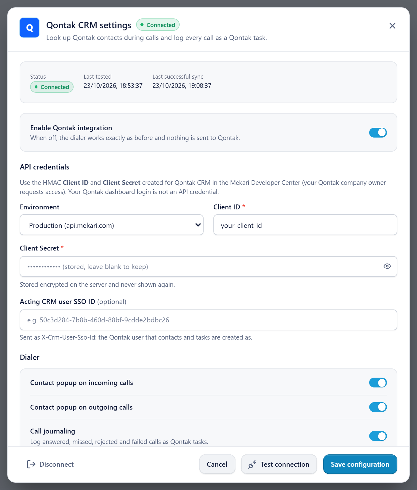
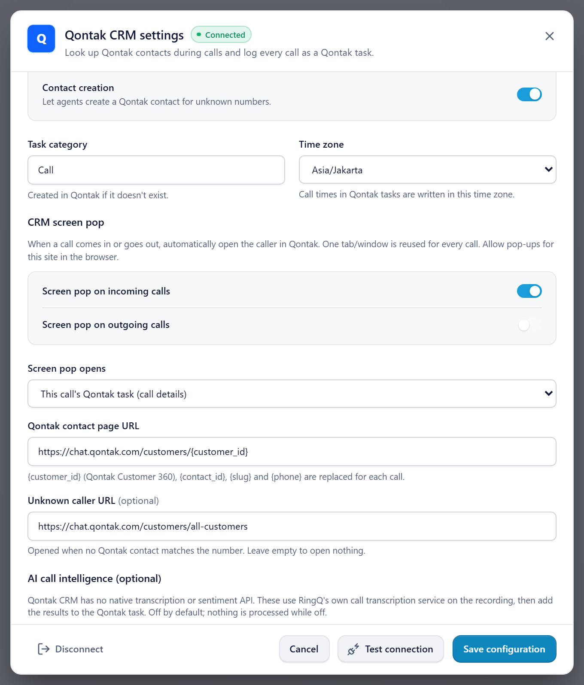
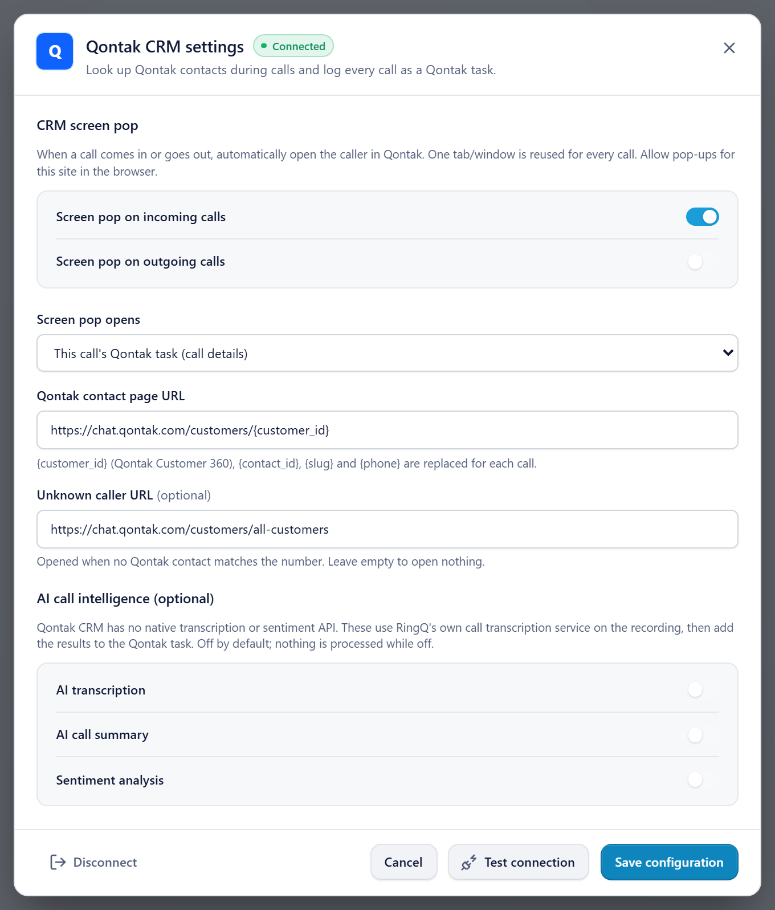

# RingQ + Qontak CRM: setup and user guide

1. [What the integration does](#1-what-the-integration-does)
2. [Before you start](#2-before-you-start)
3. [Get the Qontak API credentials (Mekari)](#3-get-the-qontak-api-credentials-mekari)
4. [Install the RingQ side on the server (RingQ admin)](#4-install-the-ringq-side-on-the-server-ringq-admin)
5. [Configure Qontak in RingQ](#5-configure-qontak-in-ringq)
6. [Making and taking calls](#6-making-and-taking-calls)
7. [Where call details and recordings appear](#7-where-call-details-and-recordings-appear)
8. [Troubleshooting](#8-troubleshooting)
9. [Reference: files, data and security](#9-reference-files-data-and-security)

Step-by-step setup (keys, install, RingQ settings, test call): [`../setup/QONTAK_SETUP.md`](../setup/QONTAK_SETUP.md). Technical install reference: [`INSTALL.md`](INSTALL.md).

---

## 1. What the integration does

Qontak CRM (by Mekari) has contacts and **tasks**, but no call-log object in its API. RingQ therefore logs each call as **one Qontak task** on the caller's contact, in a task category named by the admin (default **Call**).

| When | What happens |
|---|---|
| A call rings or starts | RingQ finds the caller's Qontak contact by phone number (Indonesian formats `0812…`, `62812…`, `+62812…` all match). The RingQ popup shows it. The Qontak task is created right away (status *In Progress*), so the screen pop can open it during the call. |
| The call ends | The same task is updated: final status, times, duration, agent, contact, company and deal. |
| Shortly after | The **recording link** (a signed RingQ link) is added to the task. With AI transcription on, the transcript is added too. |

One RingQ call is always one Qontak task. If Qontak is slow, offline or switched off, RingQ calls work exactly as before.

---

## 2. Before you start

| You need | Notes |
|---|---|
| **Qontak CRM API access** for your company | Requested by the Qontak **company owner** in the Mekari Developer Center. Your Qontak dashboard login does **not** work for the API. |
| An **HMAC Client ID and Client Secret** for Qontak CRM | Created in the Mekari Developer Center (section 3). |
| **Admin** access to RingQ | To save the Qontak settings. |
| Root access to the RingQ server | Once, to install the backend (section 4). |
| Call recording on the RingQ extension or queue | Only if you want recordings in Qontak. |

---

## 3. Get the Qontak API credentials (Mekari)

1. The Qontak company owner signs in at the **Mekari Developer Center** (https://developers.mekari.com) with their Mekari account.
2. Request access to the **Qontak CRM** API for your company, if it is not enabled yet.
3. Create an application with **HMAC authentication** for Qontak CRM.
4. Copy the **Client ID** and **Client Secret**.
5. Optional: the **SSO ID** (a UUID) of the Qontak user that contacts and tasks should be created as.

Reference: https://developers.mekari.com/docs/kb/hmac-authentication

Keep the Client Secret private. If it is ever shared, create a new secret in the Developer Center and enter it in RingQ (section 5).

---

## 4. Install the RingQ side on the server (RingQ admin)

Done **once per RingQ server**. Full details: [`INSTALL.md`](INSTALL.md).

1. **Files:** the Qontak files are part of this backend's `app/` (deployed to `/var/www/ringq/app/`):
   - `app/controllers/QontakController.php`
   - `app/library/Qontak/` (5 files)
   - `app/tasks/QontakTask.php`
2. **Encryption key** (server only, never in Git). The Client Secret is stored encrypted with this key:

   ```bash
   sudo mkdir -p /etc/ringq
   sudo sh -c 'head -c 32 /dev/urandom | base64 > /etc/ringq/qontak.key'
   sudo chown root:www-data /etc/ringq/qontak.key
   sudo chmod 0640 /etc/ringq/qontak.key
   ```

   **Back it up.** If it is lost, the stored secret must be entered again.
3. **Database:**

   ```bash
   sudo -u postgres psql -d ringq -v ON_ERROR_STOP=1 < app/scripts/qontak/2026_10_14_qontak_crm.sql
   ```

4. **Access rules** (`app/config/services.php`), one line in each list:

   ```php
   // in $privately:
   "qontak" => ["config", "testConnection", "disconnect", "contactsSearch", "contacts", "callEvents", "callJournals", "recordingsSync", "aiAnalysis", "webhooks", "recording"],
   // in $publicly:
   "qontak" => ["webhooks", "recording"],
   ```

5. **Background jobs:** in `app/tasks/tasks.txt` (RingQ's `jobs.sh` builds root's crontab from it):

   ```
   */1 * * * * /usr/bin/php /var/www/ringq/app/cli.php qontak sync
   15 3 * * * /usr/bin/php /var/www/ringq/app/cli.php qontak prune
   ```

   `app/tasks/tasks.txt` in this backend already lists both lines.
6. **Reload PHP:** `sudo systemctl reload php7.4-fpm`.

---

## 5. Configure Qontak in RingQ

In RingQ, as an admin: **Settings → Integrations → CRM → Qontak → Configure**.


*Settings → Integrations → CRM. Click **Configure** on the Qontak card.*



*Top of the Qontak settings: status, the **Enable** switch, **Environment**, **Client ID**, **Client Secret** (masked once stored) and the optional **Acting CRM user SSO ID**. Screenshots use sample data.*

1. Switch **Enable Qontak integration** on.
2. **Environment:** Production (`api.mekari.com`) or Sandbox (`api.mekari.io`).
3. Enter **Client ID** and **Client Secret** (section 3), and optionally **Acting CRM user SSO ID**.
4. Click **Test connection**, then **Save configuration**. The status should be **Connected**.



*Contact creation, **Task category** and **Time zone**, and the CRM screen pop with its page addresses.*



*What the screen pop opens (the call's Qontak task, the customer page, or a RingQ window) and the optional AI call intelligence.*

After saving, the secret field shows "stored, leave blank to keep". **Disconnect** deletes the stored secret, stops logging, and revokes every recording link already in Qontak. Tasks already in Qontak are kept.

| Setting | Default | What it does |
|---|---|---|
| Contact popup on incoming / outgoing calls | On | Shows the caller's Qontak contact in RingQ during calls. |
| Call journaling | On | Logs answered, missed, rejected and failed calls as Qontak tasks. |
| Contact creation | Off | Lets agents create a Qontak contact (first name, last name, email) for an unknown number from the popup. Never creates duplicates. |
| Task category | `Call` | Category of the call tasks. Created in Qontak if it does not exist. |
| Time zone | your PC's zone | Times written into tasks. |
| Screen pop on incoming / outgoing calls | Off | Opens the caller in Qontak automatically. Allow pop-ups for the RingQ site. |
| Screen pop opens | This call's Qontak task | **Task:** Qontak's task list filtered to this call (`app.qontak.com/crm/tasks?task_name=RQ…`). **Customer page:** the contact's Customer 360 page (`chat.qontak.com/customers/{customer_id}`). **RingQ window:** a separate RingQ call-details window. |
| Qontak contact page URL / Unknown caller URL | Customer 360 / All customers | Address templates for the customer-page screen pop (`{customer_id}`, `{contact_id}`, `{slug}`, `{phone}`). |
| AI transcription / summary / sentiment | Off | Transcription uses RingQ's own service and adds the text to the task. Summary and sentiment stay inactive until an analysis provider exists. |

---

## 6. Making and taking calls

- **Incoming:** the RingQ popup shows the Qontak contact (name, phone, email, company, owner, status). With screen pop on, Qontak opens on the call's task (or the customer page).
- **Outgoing:** dial in RingQ as usual; the popup shows the contact for that number.
- **After the call:** the popup shows **Qontak log: Synced** ("Call saved to Qontak with recording link"). If it fails, **Retry**. With AI transcription on, the transcript appears when ready.
- **Unknown number:** "No Qontak contact matches…" with **Create contact** (if Contact creation is on).
- **Several contacts share a number:** pick the right one in the popup; the task is linked to it.

---

## 7. Where call details and recordings appear

### In Qontak

**CRM → Tasks** (filter by the category, e.g. *Call*), or the contact's tasks.

| Part | Content |
|---|---|
| Task name | e.g. `Outbound call - Answered - Jane Tan (0812…) - Agent name - RQ1a2b3c4d` |
| Status | **Completed** for answered calls; **In Progress** while the call is live; **Not Started** for missed/unanswered calls (a call-back to-do) |
| Due date | When the call ended |
| Category | The task category from the settings |
| Linked to | The contact, and its company and first deal |
| Detail | Direction · Status · Contact · Number · Agent (name and extension) · Started · Answered · Ended · Duration · Talk time · RingQ call ID · **Recording** (link and the address as text) · AI summary / sentiment / transcription |

**Recording:** Qontak's API cannot store audio, so the task holds a **signed RingQ link**. Qontak shows task details in a rich-text editor where links may not be clickable, so the address is also written as text: copy it into the browser to play the call. Links stay valid until **Disconnect**.

### In RingQ


*The RingQ popup after a call: the Qontak contact (job title, phone, email, company, owner, status), the call, and **Qontak log: Synced — Call saved to Qontak with recording link**.*

The popup during and after each call, and **Call Logs** as before (same recording).

---

## 8. Troubleshooting

| Symptom | Cause | Fix |
|---|---|---|
| **Qontak rejected the credentials (HTTP 401)** | Wrong Client ID/Secret, or the server clock is off (HMAC allows 300 s). | Check the credentials; sync the server time (`timedatectl`). |
| **lack permission (HTTP 403)** | The credentials do not include Qontak CRM, or the acting user may not do this. | Ask the company owner to grant Qontak CRM API access; check the SSO ID. |
| **Qontak database tables are missing** | SQL not run. | Section 4.3. |
| **The app database user cannot access the Qontak tables** | Missing grant. | `GRANT` from `INSTALL.md` step 4. |
| Saving fails with an encryption error | `/etc/ringq/qontak.key` missing or unreadable by PHP-FPM. | Section 4.2. |
| **Sorry, this is not available (AC4031)** / redirect to index | Access rules missing. | Section 4.4. |
| Recording link opens "not found" | Integration disconnected (links revoked), or no recording for the call. | Reconnect; check recording is on for the extension. |
| Screen pop doesn't open | Pop-ups blocked, or the contact has no Customer 360 id yet. | Allow pop-ups; use "This call's Qontak task". |
| Failed syncs not retried | Cron lines missing. | Section 4.5. |

Logs: `grep "\[qontak\]" /var/log/php7.4-fpm.log` (method, path, status and Qontak's error text only; never secrets).

---

## 9. Reference: files, data and security

| Path | What |
|---|---|
| `app/controllers/QontakController.php` | API `qontak/*` |
| `app/library/Qontak/QontakService.php` | Settings, contact lookup, task journaling, recordings, webhooks |
| `app/library/Qontak/QontakClient.php` | Mekari API Gateway client (HMAC signing) |
| `app/library/Qontak/QontakCrypto.php` | Secret encryption (key file `/etc/ringq/qontak.key`), signed links |
| `app/library/Qontak/QontakAi.php` | RingQ transcription provider |
| `app/library/Qontak/QontakException.php` | Error type |
| `app/tasks/QontakTask.php` | `cli.php qontak sync` / `prune` / `after` |
| `app/scripts/qontak/` | Tables `q_qontak_config`, `q_qontak_call_journals`, `q_qontak_webhook_events` (+ rollback, full schema) |

The RingQ settings screen and call popup are part of the RingQ web app (`src/integrations/qontak/` in the frontend repository).

Security: the Client Secret is stored encrypted (key on the server only) and never returned to the browser or logged; recording links are signed, tenant-bound and revoked by Disconnect; webhook URLs carry a per-tenant secret token; every query is limited to the logged-in tenant.
