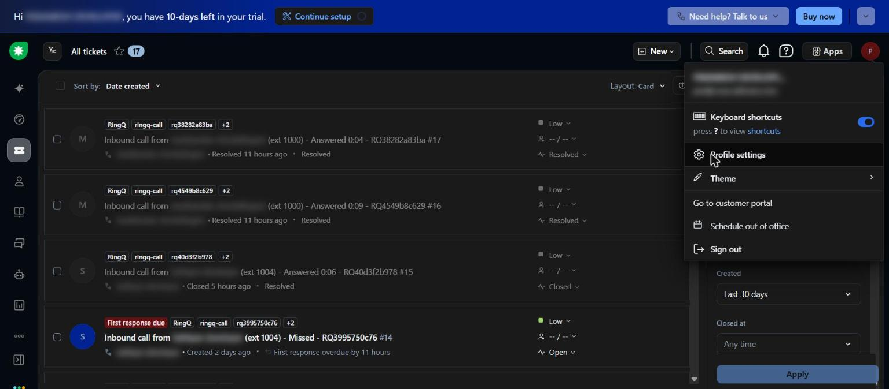
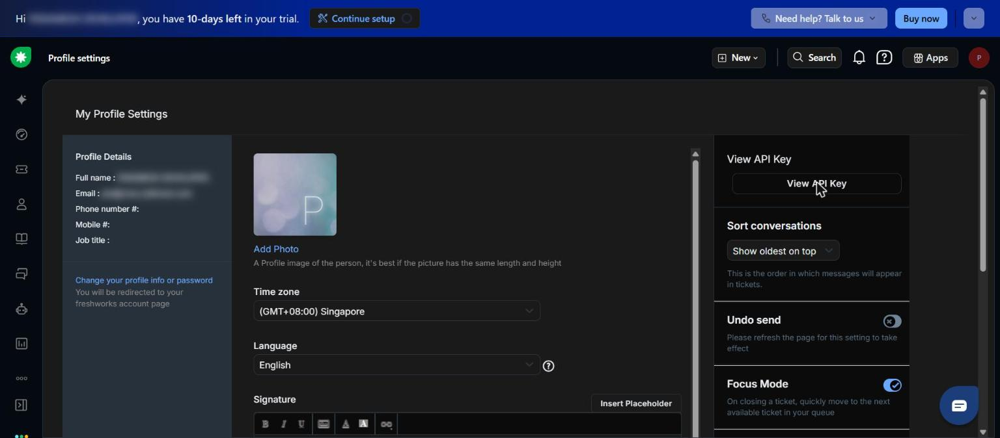
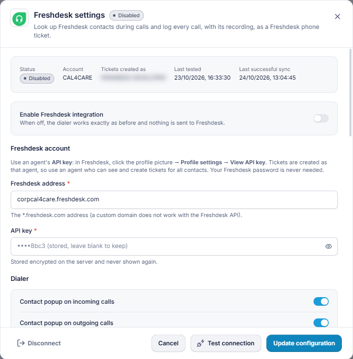
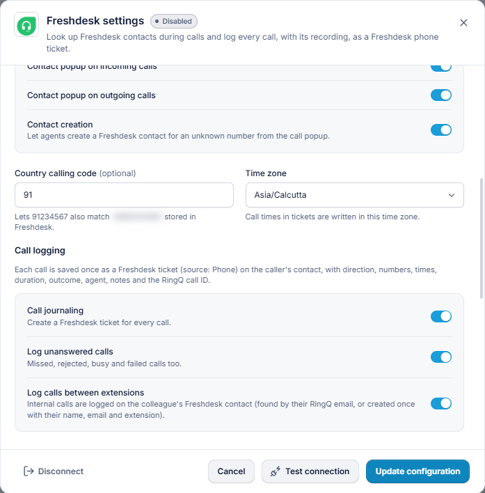
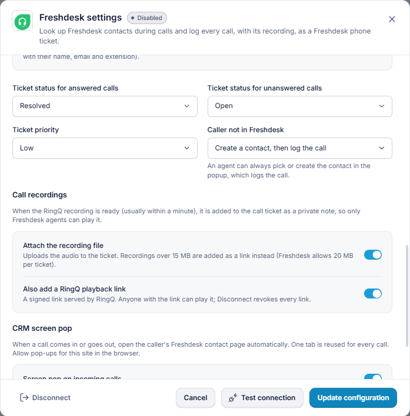
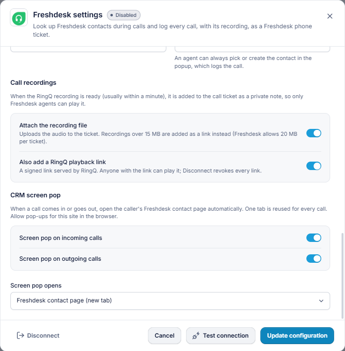
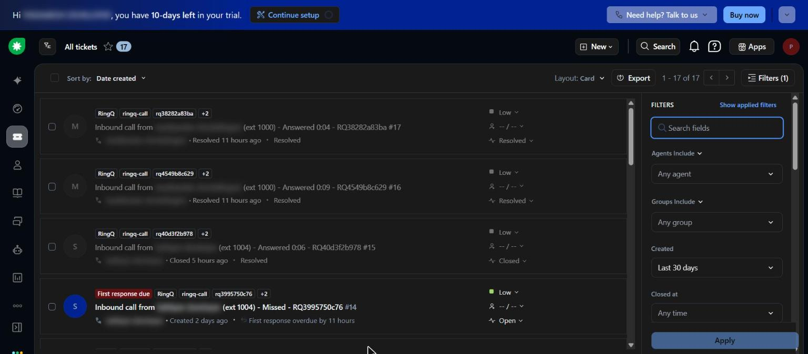
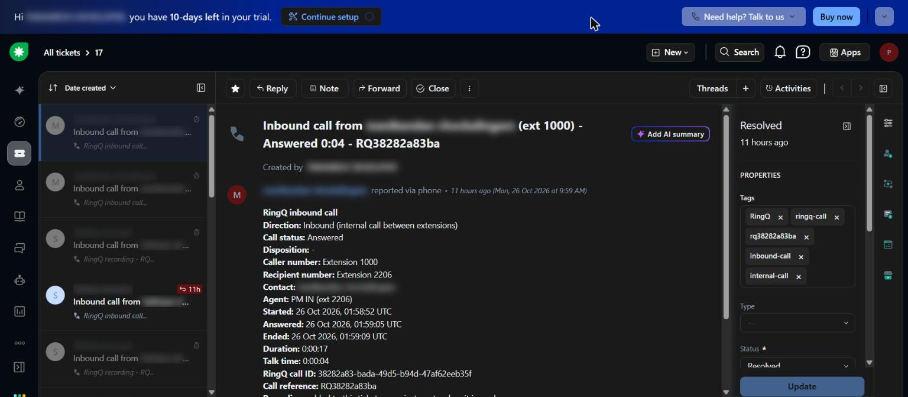
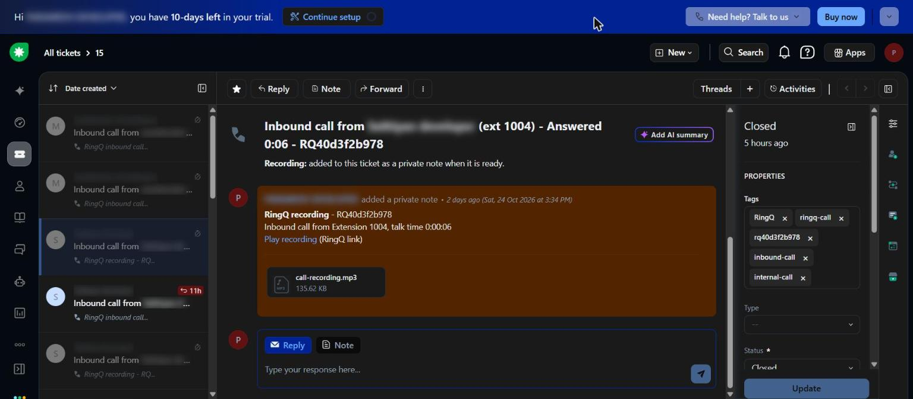

# RingQ + Freshdesk: complete setup guide

From nothing to a working Freshdesk integration: get the address and API key in Freshdesk, install, configure RingQ, make a test call, and find every call ticket and recording in Freshdesk. Every step has a screenshot. Personal data in the screenshots is blurred.

For day-to-day use and troubleshooting, see the [Freshdesk user guide](../freshdesk/USER_GUIDE.md).

| | |
|---|---|
| **What you need** | The help desk **address** (`yourcompany.freshdesk.com`) and an agent's **API key** |
| **Who gets the key** | The Freshdesk **agent** RingQ will create tickets as (each agent has their own key) |
| **Where they go in RingQ** | Settings → Integrations → CRM → Freshdesk → **Freshdesk address** and **API key** |
| **Not needed** | Your Freshdesk password, a developer account, any Freshworks marketplace app |

Calls are made and answered in RingQ. Freshdesk receives the contact lookup, **one Phone ticket per call**, and the recording as a private note. There is no dialer inside Freshdesk.

**Contents**

- [Part A. Get the address and API key in Freshdesk](#part-a-get-the-address-and-api-key-in-freshdesk)
- [Part B. Install the RingQ side on the server](#part-b-install-the-ringq-side-on-the-server-once-per-server)
- [Part C. Configure Freshdesk in RingQ](#part-c-configure-freshdesk-in-ringq)
- [Part D. Test with a real call](#part-d-test-with-a-real-call)
- [Part E. Where calls and recordings appear in Freshdesk](#part-e-where-calls-and-recordings-appear-in-freshdesk)
- [Part F. Reset, change or remove the key](#part-f-reset-change-or-remove-the-key)
- [Checklist](#checklist)

---

## Part A. Get the address and API key in Freshdesk

### Step A1. Choose the agent

Tickets are created **as the agent whose key you use**. Pick an agent who can view and create contacts and tickets for all customers (an admin, or a dedicated agent such as "RingQ").

### Step A2. Sign in and copy the help desk address

1. Sign in to Freshdesk as that agent.
   - Newer Freshworks accounts sign in at `yourcompany.myfreshworks.com`. That is **only the sign-in page**; the Freshdesk API does not work on it.
2. Open the help desk itself (**Tickets**).
3. Copy the host name from the browser's address bar:

   ```
   https://yourcompany.freshdesk.com/a/tickets
           └──── this part ────────┘
   ```

A custom help desk domain (e.g. `support.yourcompany.com`) does not work with the Freshdesk API; use the `*.freshdesk.com` address.

### Step A3. Open Profile settings

Click your **profile picture** (top right) → **Profile settings**.



### Step A4. View and copy the API key

On the right of **My Profile Settings**, click **View API Key**. Complete the check if Freshdesk asks for one, then copy the key.



- Classic keys are a short string of letters and digits.
- Newer Freshworks accounts show a key starting with `fwapi_`. Both work.

Keep the key secret: anyone with it can act as that agent. If it is ever shared (chat, email, screenshot), reset it on the same page and enter the new key in RingQ.

### Step A5. Check ticket fields (one time)

RingQ cannot fill custom ticket fields. In **Admin → Ticket fields**, make sure no custom field is **required for agents when submitting**. Otherwise Freshdesk refuses the call tickets. RingQ shows a warning in its settings if it finds one.

---

## Part B. Install the RingQ side on the server (once per server)

Done by the RingQ server admin, as root, from a checkout or copy of this repository:

```bash
sudo bash server-configs/freshdesk/install.sh
```

Other app folder, database or database user:

```bash
sudo APP=/var/www/ringq DB=ringq DB_USER=<app_db_user> bash server-configs/freshdesk/install.sh
```

The installer (safe to run again):

1. copies the Freshdesk controller, library and task into `/var/www/ringq/app/` and checks their syntax;
2. creates the three `q_freshdesk_*` tables (`app/scripts/freshdesk/2026_10_23_freshdesk_crm.sql`);
3. schedules `cli.php freshdeskcrm sync` (already listed in `app/tasks/tasks.txt`);
4. reloads PHP-FPM;
5. checks that `https://<server>:8443/freshdeskcrm/config` answers **401** (installed).

No change to `app/config/services.php` is needed: the Freshdesk controller registers its own access rules. The server must reach `https://<account>.freshdesk.com` on port 443.

---

## Part C. Configure Freshdesk in RingQ

### Step C1. Open Global Settings → Integrations

Sign in to RingQ as an **admin**. In the left menu click **Global Settings**, then under **Tools** click **Integrations**.


### Step C2. Open the Freshdesk card

On the **CRM** tab, click the **Freshdesk** card (or its **Configure** link). The card shows the status: Not configured, Enabled, Disabled or Connection error.


### Step C3. Enter the address and key



1. Switch **Enable Freshdesk integration** on.
2. **Freshdesk address**: the address from Step A2 (`yourcompany.freshdesk.com`; a full URL is fine, RingQ keeps the host).
3. **API key**: the key from Step A4.
4. Click **Test connection**. A green result shows the account and the agent.
5. Click **Save configuration** (**Update configuration** once saved). **Status** changes to **Connected**, with:
   - **Account**: your Freshdesk account name;
   - **Tickets created as**: the agent from Step A1.

After saving, the key field shows `••••xxxx (stored, leave blank to keep)`. Leave it blank when you change other settings.

### Step C4. Set country code, time zone and call options

Scroll down in the same window.







| Setting | Recommended | Notes |
|---|---|---|
| Contact popup on incoming / outgoing calls | On | Shows the Freshdesk contact in RingQ during calls |
| Contact creation | On | Agents can create a contact for an unknown number |
| **Country calling code** | **Set it** (e.g. `91`, `65`) | Lets `9876543210` match `+919876543210` in Freshdesk |
| **Time zone** | Your zone (e.g. `Asia/Kolkata`) | Not `UTC`, unless you want UTC times in tickets |
| Call journaling | On | One Phone ticket per call |
| Log unanswered calls | On | Missed calls get an Open ticket for call-back |
| Log calls between extensions | On | Internal calls go on the colleague's contact |
| Ticket status: answered / unanswered | Resolved / Open | |
| Ticket priority | Low | |
| Caller not in Freshdesk | Don't log in Freshdesk | Or "Create a contact, then log the call" |
| Attach the recording file | On | The recording is attached to the ticket as a private note |
| Also add a RingQ playback link | Off | Optional signed link |
| Screen pop on incoming / outgoing calls | Your choice | Allow pop-ups for the RingQ site |

Click **Save configuration**.

---

## Part D. Test with a real call

1. Make sure a Freshdesk contact has your test phone number in **Work phone** or **Mobile phone**.
2. Call the RingQ extension from that phone (or dial the number from RingQ).
3. While it rings, the RingQ popup shows the Freshdesk contact (name, phone, email, company).
4. Answer, talk a few seconds, hang up.
5. The popup shows **Freshdesk ticket: Saved as ticket #…**, then **Recording attached**. Pick an outcome, type a note, click **Save notes**.


6. Click **Open ticket** in the popup, or check Freshdesk as shown in Part E.

If something is missing, see [Troubleshooting](../freshdesk/USER_GUIDE.md#9-troubleshooting).

---

## Part E. Where calls and recordings appear in Freshdesk

### E1. Tickets list

**Tickets → All tickets** shows one ticket per call, tagged `RingQ` and `ringq-call`. Filter by the tag `ringq-call` to see only calls.



Each card shows the tags (`RingQ`, `ringq-call`, the call reference), the subject (`Inbound call from <contact> (ext …) - Answered 0:04 - RQ… #17`) and the ticket status (answered calls Resolved, missed calls Open).

### E2. The call ticket

Open a ticket. The description holds all call details; the tags are on the right.



| Part | Content |
|---|---|
| Subject | Direction, contact, result, talk time, call reference `RQ…` |
| Source | **Phone** (phone icon) |
| Description | Direction, call status, disposition, caller and recipient numbers, contact, agent (name and extension), started / answered / ended, duration, talk time, RingQ call ID, call reference |
| Tags | `RingQ`, `ringq-call`, `rq…` (call reference), `inbound-call` / `outbound-call`, `internal-call` for calls between extensions |
| Status / priority | From the RingQ settings |

### E3. The recording

About a minute after hang-up, RingQ adds a **private note** (agents only) with the recording attached:



- **RingQ recording – RQ…**: the call it belongs to and the talk time.
- **call-recording.mp3**: click to download and play.
- **Play recording**: only when "Also add a RingQ playback link" is on.

Agent notes and the outcome typed in the RingQ popup are added as another private note on the same ticket.

---

## Part F. Reset, change or remove the key

| Task | How |
|---|---|
| **Reset the key** (shared or leaked) | Freshdesk → profile picture → **Profile settings** → reset the API key. Paste the new key in RingQ (Step C3) and save. |
| **Change the agent** | Get the other agent's key (Step A4) and paste it in RingQ. New tickets are created as that agent. |
| **Disconnect** | RingQ Freshdesk settings → **Disconnect**. Deletes the stored key, stops logging and revokes playback links. Tickets already in Freshdesk stay. |

---

## Checklist

- [ ] Agent chosen; help desk address (`*.freshdesk.com`) and API key copied
- [ ] No custom ticket field required for agents
- [ ] Server: `install.sh` finished with `freshdeskcrm/config -> HTTP 401`
- [ ] RingQ: address and key entered, **Test connection** green, saved, status **Connected**, country code and time zone set
- [ ] Test call appears as a Phone ticket with the recording attached
