# RingQ + HubSpot: complete setup guide

From nothing to a working HubSpot integration: create the key in HubSpot, install, configure RingQ, make a test call, and find every call and recording in HubSpot. Every step has a screenshot. Personal data in the screenshots is blurred.

For day-to-day use and troubleshooting, see the [HubSpot user guide](../hubspot/USER_GUIDE.md).

| | |
|---|---|
| **Key you need** | A HubSpot **service key** (newer accounts) or **private app access token** (older accounts). Both start with `pat-` and work the same way in RingQ. |
| **Who creates it** | A HubSpot **Super Admin** |
| **Where it goes in RingQ** | Settings → Integrations → CRM → HubSpot → **Private app access token** |
| **Scopes** | `crm.objects.contacts.read`, `crm.objects.contacts.write` (required), `crm.objects.companies.read` (optional) |
| **Not needed** | Your HubSpot password, a developer account, a marketplace app |

Calls are made and answered in RingQ. HubSpot receives the contact lookup, one **Call** record per call, and the recording. There is no dialer inside HubSpot.

**Contents**

- [Part A. Create the key in HubSpot](#part-a-create-the-key-in-hubspot)
- [Part B. Install the RingQ side on the server](#part-b-install-the-ringq-side-on-the-server-once-per-server)
- [Part C. Configure HubSpot in RingQ](#part-c-configure-hubspot-in-ringq)
- [Part D. Test with a real call](#part-d-test-with-a-real-call)
- [Part E. Where calls and recordings appear in HubSpot](#part-e-where-calls-and-recordings-appear-in-hubspot)
- [Part F. Rotate, disconnect or remove the key](#part-f-rotate-disconnect-or-remove-the-key)
- [Checklist](#checklist)

---

## Part A. Create the key in HubSpot

### Step A1. Sign in and open Development

1. Sign in at **https://app.hubspot.com** as a **Super Admin**.
2. If you have several HubSpot accounts, open the one RingQ should log calls into. The key works only for that account.
3. Open **Development** from the main menu (or the **Settings** gear → **Integrations**).

### Step A2. Check which kind of key your account uses

Open **Development → Legacy Apps**.

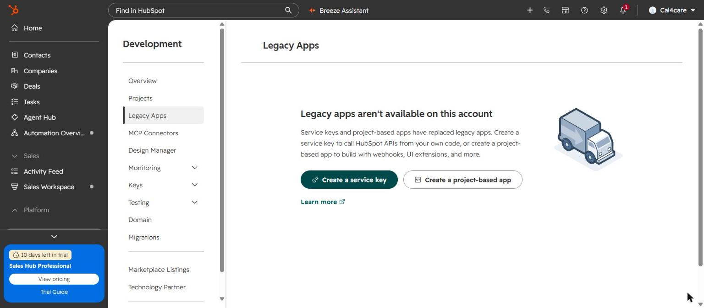

- If the page says **"Legacy apps aren't available on this account"** (as above), use a **service key**: continue with Step A3.
- If the page lists **private apps** and offers **Create a private app**, you can use a private app instead: see [Older accounts: private app](#older-accounts-private-app) below. RingQ works the same with either.

### Step A3. Open Service Keys

Go to **Development → Keys → Service Keys**.

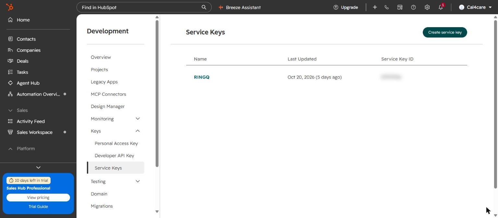

If a key for RingQ already exists (here **RINGQ**), you can reuse it: skip to Step A6. Otherwise click **Create service key**.

### Step A4. Name the key

In **Name**, type `RingQ`. The name must be unique in the account.

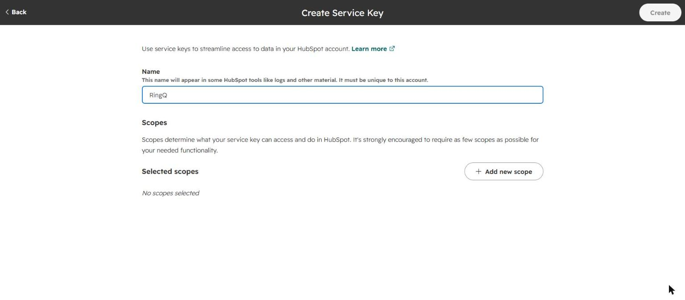

### Step A5. Add the scopes

1. Click **Add new scope**.
2. In **Find a scope**, type `crm.objects.contacts` and tick:
   - `crm.objects.contacts.read`
   - `crm.objects.contacts.write`

   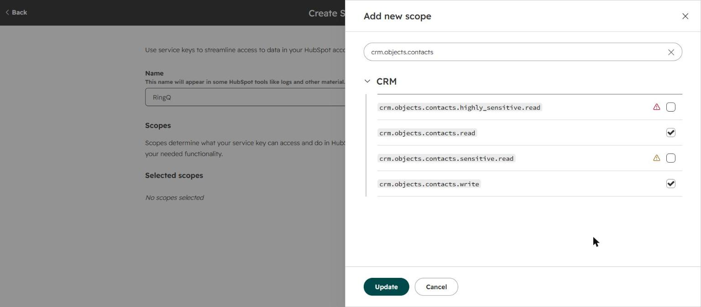

   Leave `sensitive` and `highly_sensitive` unticked; RingQ does not need them.
3. Search `crm.objects.companies.read` and tick it (optional: shows the caller's company and links calls to it).
4. Click **Update**. **Selected scopes** now lists the three scopes:

   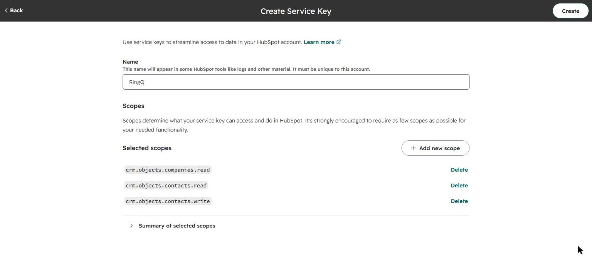

5. Click **Create** (top right).

| Scope | Required? | Why |
|---|---|---|
| `crm.objects.contacts.read` | **Required** | Find the caller's contact by phone |
| `crm.objects.contacts.write` | **Required** | Log calls on the contact, create contacts |
| `crm.objects.companies.read` | Optional | Show the company and link calls to it |

`crm.schemas.companies.read` is a different scope (company *properties*, not companies) and does not replace `crm.objects.companies.read`.

### Step A6. Copy the key

Open the key (click its name in **Service Keys**). Under **Service Key**, click **Copy**.

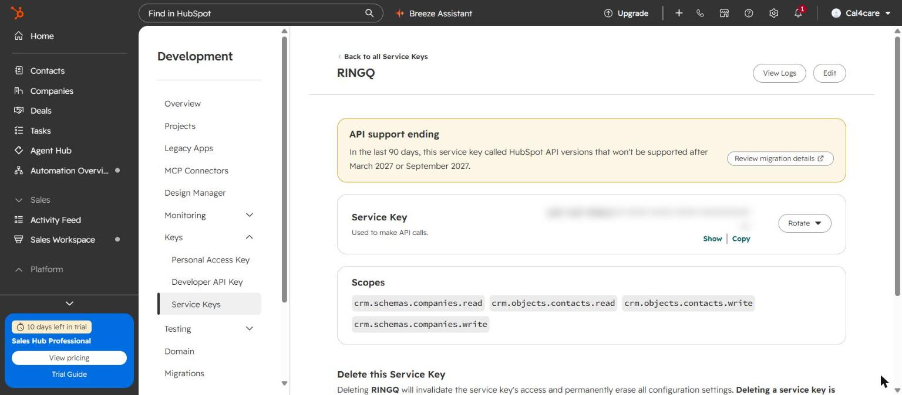

- The key starts with `pat-` (for example `pat-na2-…`).
- **Scopes** shows what the key may do. Check that the required scopes are listed; to add one, click **Edit**.
- Keep the key secret: anyone with it can read and change your HubSpot contacts. Don't send it by chat or email.

### Older accounts: private app

If your account still has private apps (**Settings → Integrations → Private Apps**, or **Development → Legacy apps → Create legacy app → Private**):

1. Click **Create a private app**, name it `RingQ`.
2. On the **Scopes** tab tick the same scopes as in Step A5.
3. Click **Create app**, then on the **Auth** tab click **Show token** → **Copy**.

The private app token also starts with `pat-` and goes into the same RingQ field.

---

## Part B. Install the RingQ side on the server (once per server)

Done by the RingQ server admin, as root. The HubSpot files are part of this backend.

| Step | Command / action |
|---|---|
| B1. Deploy this backend's `app/` | To `/var/www/ringq/app/`. It includes `HubspotcrmController.php`, `app/library/Hubspot/`, `HubspotcrmTask.php`, the access rules in `app/config/services.php` and the cron line in `app/tasks/tasks.txt`. |
| B2. Create the tables | `sudo -u postgres psql -d ringq -v ON_ERROR_STOP=1 < app/scripts/hubspot/2026_10_21_hubspot_crm.sql` then `sudo -u postgres psql -d ringq -v ON_ERROR_STOP=1 < app/scripts/hubspot/2026_10_22_hubspot_cti.sql` |
| B3. Recording links in nginx | In the `listen 8443` server block, **before** the static-file rule, add the block below, then `sudo nginx -t && sudo systemctl reload nginx`. |
| B4. Reload PHP | `sudo systemctl reload php7.4-fpm` |
| B5. Check | `curl -s -o /dev/null -w '%{http_code}\n' https://<server>:8443/hubspotcrm/config` prints **401** |

```nginx
location ^~ /hubspotcrm/recording/ {
    try_files /nonexistent /index.php?_url=$uri&$args;
}
```

HubSpot only plays recording links that end in `.wav` or `.mp3`; without B3 nginx answers them with 404 and recordings don't play in HubSpot.

---

## Part C. Configure HubSpot in RingQ

### Step C1. Open Global Settings → Integrations

Sign in to RingQ as an **admin**. In the left menu click **Global Settings**, then under **Tools** click **Integrations**.


### Step C2. Open the HubSpot card

On the **CRM** tab, click the **HubSpot** card (or its **Configure** link). The card shows the status: Not configured, Enabled, Disabled or Connection error.


### Step C3. Paste the key and test

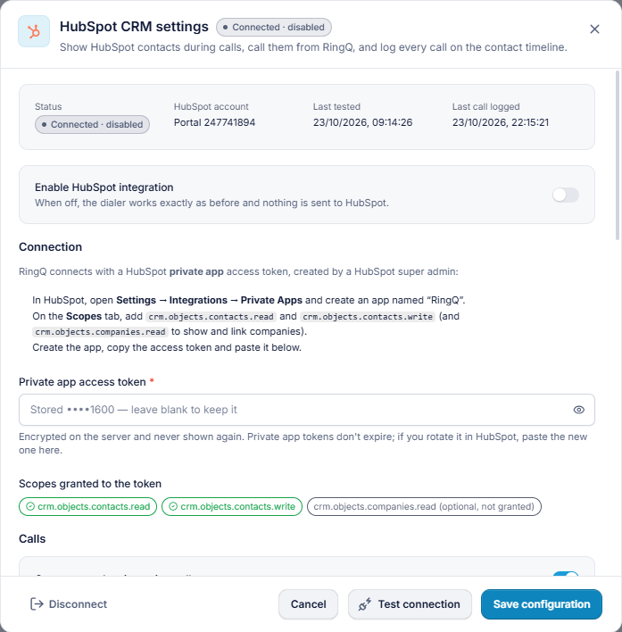

1. Switch **Enable HubSpot integration** on.
2. Paste the key from Step A6 into **Private app access token** (a service key goes in the same field).
3. Click **Test connection**. RingQ checks the key and shows:
   - **HubSpot account**: your portal number (here *Portal 247741894*);
   - **Scopes granted to the token**: a green chip for each granted scope. *crm.objects.companies.read (optional, not granted)* means the optional company scope is missing (Step A5).
4. Click **Save configuration**. **Status** changes to **Connected** (or *Connected · disabled* while the Enable switch is off).

After saving, the field shows `Stored ••••xxxx — leave blank to keep it`. Leave it blank when you change other settings.

### Step C4. Choose the call options

Scroll down in the same window.

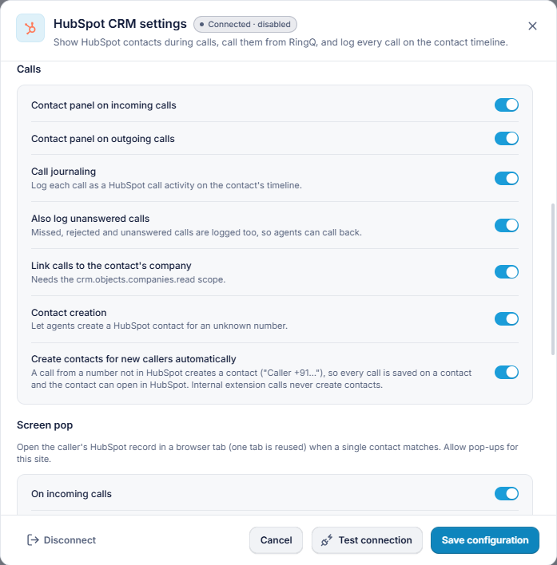

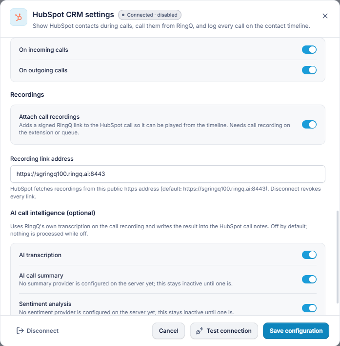

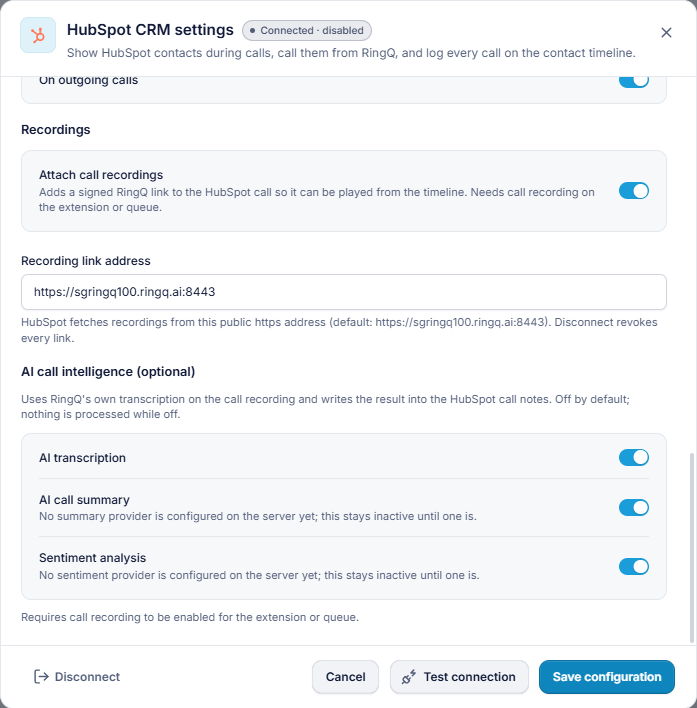

| Setting | Recommended | Notes |
|---|---|---|
| Contact panel on incoming / outgoing calls | On | Shows the HubSpot contact in RingQ during calls |
| Call journaling | On | Logs every call on the contact's timeline |
| Also log unanswered calls | On | So missed calls can be called back |
| Link calls to the contact's company | On | Needs `crm.objects.companies.read` |
| Contact creation | On | Agents can create a contact for an unknown number |
| Create contacts for new callers automatically | Off | Turn on only if every caller should become a contact |
| Screen pop on incoming / outgoing calls | Your choice | Opens the HubSpot record in a browser tab; allow pop-ups for RingQ |
| Attach call recordings | On | Recording plays from the HubSpot call |
| Recording link address | Empty | Set a public HTTPS address only if HubSpot cannot reach port 8443 |
| AI transcription | Off | Optional |

Click **Save configuration**.

---

## Part D. Test with a real call

1. Make sure a HubSpot contact has your test phone number in **Phone number** or **Mobile phone number**.
2. Call the RingQ extension from that phone (or dial the number from RingQ).
3. **While it rings**, the RingQ contact panel shows the HubSpot contact, and the call already appears in HubSpot with status *Ringing*.
4. Answer, talk a few seconds, hang up.
5. In the RingQ panel: **Logged**. Add a note, pick an outcome, click **Save notes**.


6. Check HubSpot as shown in Part E. The recording is added about a minute after hang-up.

If something is missing, see [Troubleshooting](../hubspot/USER_GUIDE.md#8-troubleshooting).

---

## Part E. Where calls and recordings appear in HubSpot

### E1. All calls

**CRM → Calls** (or **Activities → Calls**) lists every call RingQ logged. **Recorded calls** shows only calls with a recording.

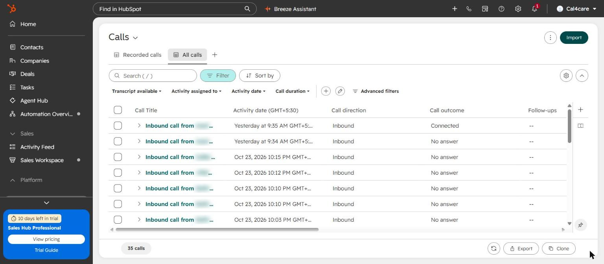

| Column | Content |
|---|---|
| Call Title | `Inbound call from <contact> - Answered - RQ…` (direction, contact, result, RingQ call reference) |
| Call direction | Inbound / Outbound |
| Call outcome | Connected, No answer, Busy… |

The same call also appears on the **contact's Activity timeline** (Contacts → the contact → Activity → Calls).

### E2. One call, with the recording

Click a call title. The call record shows the result, the **recording player** (play, skip ±15 s, speed) and the date.

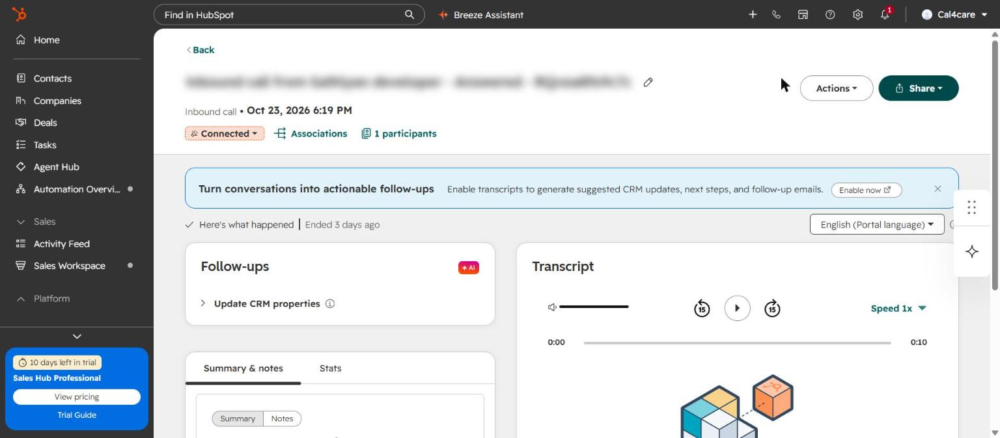

### E3. Call notes

Under **Summary & notes → Notes**, RingQ writes the call details:

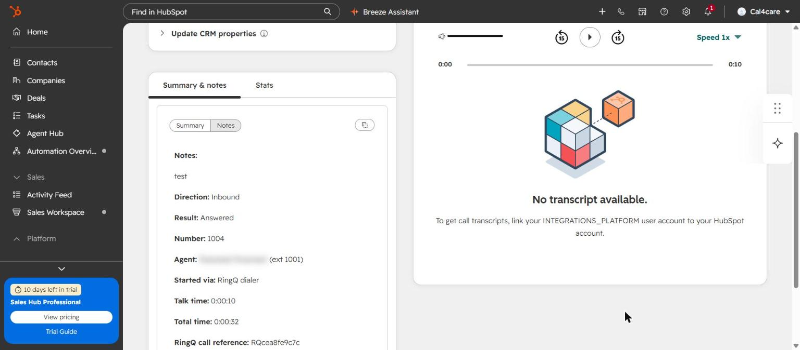

| Line | Content |
|---|---|
| Notes | The agent's notes from the RingQ panel |
| Direction / Result | Inbound or Outbound; Answered, No answer… |
| Number | The other party's number (or extension) |
| Agent | The RingQ agent and extension |
| Started via | RingQ dialer |
| Talk time / Total time | Talk time and full call time |
| RingQ call reference | `RQ…`, the same as in RingQ Call Logs |
| Transcription | Only when AI transcription is on |

---

## Part F. Rotate, disconnect or remove the key

| Task | How |
|---|---|
| **Rotate** (key shared or leaked) | HubSpot → Development → Keys → Service Keys → **RingQ** → **Rotate**. For a private app: the app → **Auth** → **Rotate**. Paste the new key in RingQ (Step C3) and save. |
| **Change scopes** | Open the key → **Edit** → add or remove scopes. The key stays the same. |
| **Disconnect** | RingQ HubSpot settings → **Disconnect**. Deletes the stored key, stops logging and revokes recording links. Calls already in HubSpot stay. |
| **Remove completely** | Disconnect in RingQ, then delete the key (or private app) in HubSpot. |

---

## Checklist

- [ ] Service key (or private app) **RingQ** with `crm.objects.contacts.read` and `crm.objects.contacts.write`
- [ ] Server: tables created, nginx recording rule added, PHP reloaded, `/hubspotcrm/config` answers 401
- [ ] RingQ: key pasted, **Test connection** green, **Save configuration**, status **Connected**
- [ ] Test call appears under HubSpot **Calls** and on the contact, with the recording
