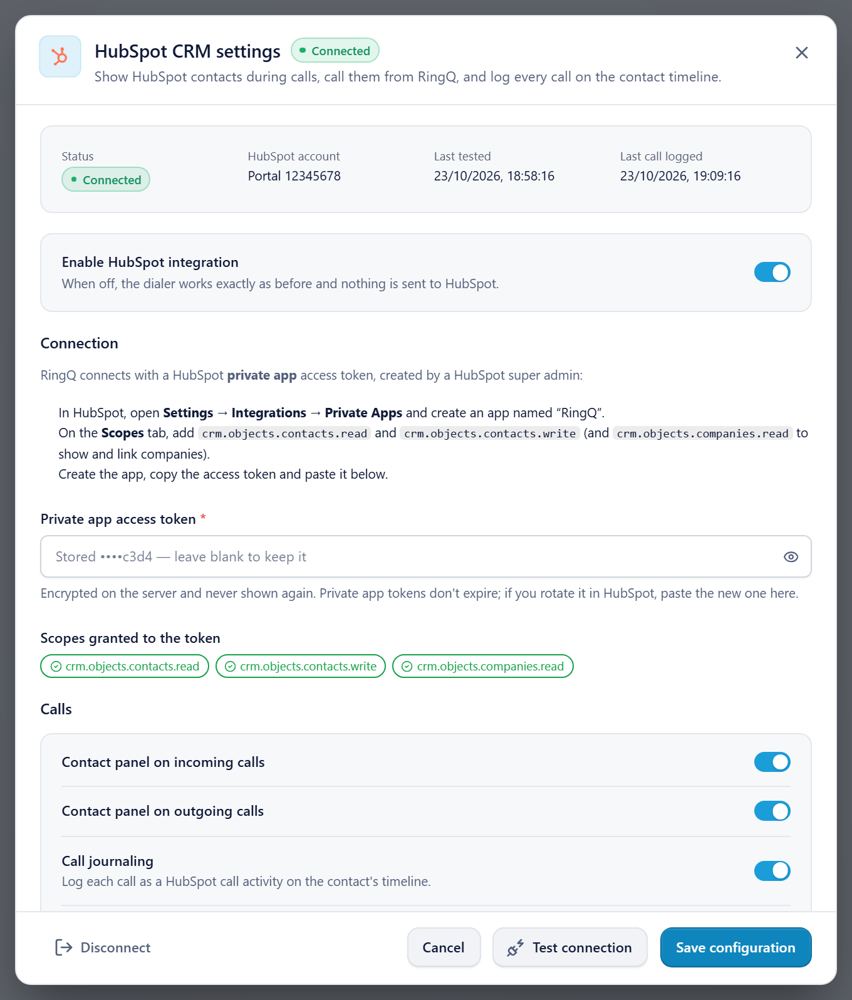
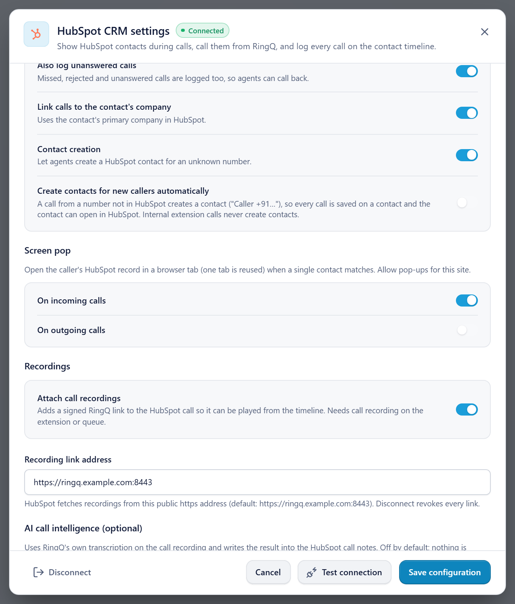
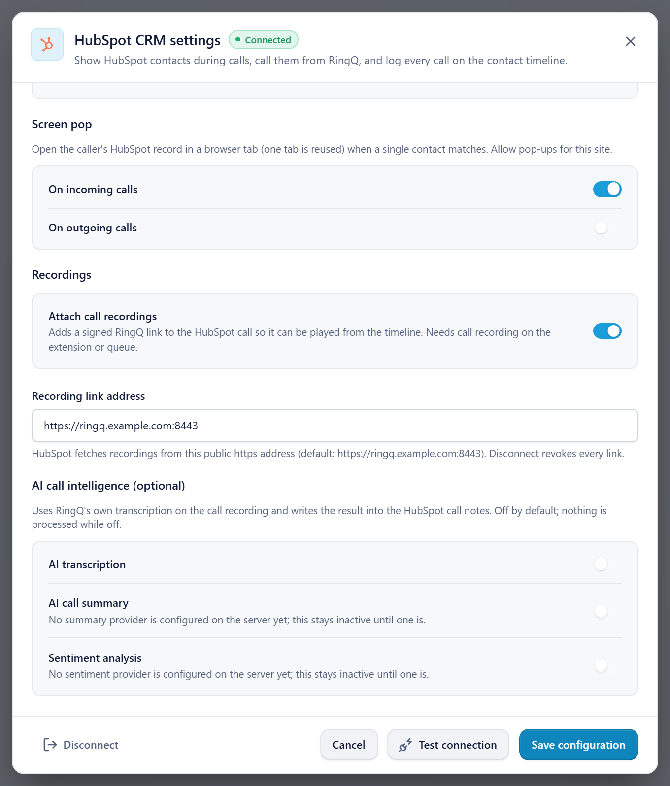
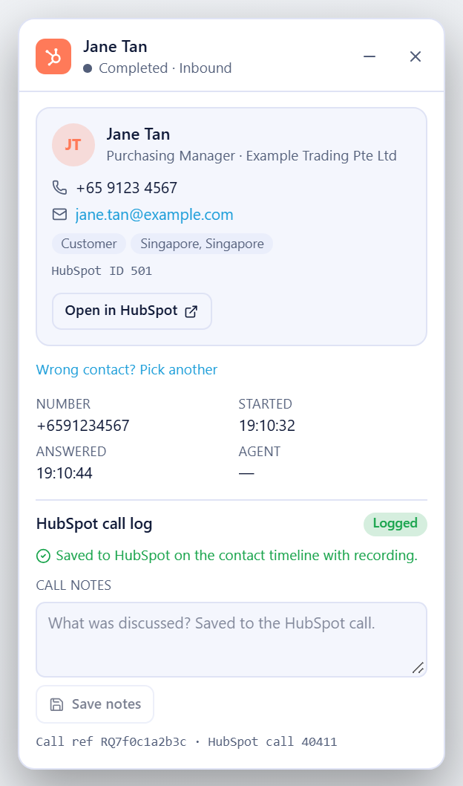

# HubSpot setup: step by step

This guide takes you from nothing to a working HubSpot integration: get the key, install, configure RingQ, test a call. For how agents use it day to day, see the [HubSpot user guide](../hubspot/USER_GUIDE.md).

| | |
|---|---|
| **Key you need** | A HubSpot **private app access token** (starts with `pat-`) |
| **Who creates it** | A HubSpot **Super Admin** (or a user allowed to create private apps) |
| **Where it goes in RingQ** | Settings → Integrations → CRM → HubSpot → **Private app access token** |
| **Not needed** | Your HubSpot password, a HubSpot developer account, an API key from other apps |
| **Time** | About 10 minutes (plus the one-time server install) |

---

## Part A. Create the HubSpot access token

### Step A1. Sign in to HubSpot

1. Open **https://app.hubspot.com**.
2. Sign in as a **Super Admin** of the HubSpot account you want RingQ to log calls into.
3. If you have several HubSpot accounts, pick the right one in the account menu (top right). The token works only for that account.

### Step A2. Open Private Apps

1. Click the **Settings** icon (gear, top right).
2. In the left menu, open **Integrations → Private Apps**.
   - In newer HubSpot accounts this is **Development → Legacy apps**. Click **Create legacy app** and choose **Private**.

### Step A3. Create the app

1. Click **Create a private app**.
2. **Basic info** tab:
   - **Name:** `RingQ`
   - **Description** (optional): `RingQ call logging`
3. **Scopes** tab. Search for each scope and tick it:

   | Scope | Required? | Why |
   |---|---|---|
   | `crm.objects.contacts.read` | **Required** | Find the caller's contact by phone |
   | `crm.objects.contacts.write` | **Required** | Log calls on the contact, create contacts |
   | `crm.objects.companies.read` | Optional | Show the company and link calls to it |

4. Click **Create app** (top right), then **Continue creating** to confirm.

### Step A4. Copy the token

1. The app opens on the **Auth** tab (or click **Auth**).
2. Under **Access token**, click **Show token**, then **Copy**.
3. The token starts with `pat-` (for example `pat-na1-…` or `pat-eu1-…`).

Keep it somewhere safe until Part C. Do not send it by chat or email: anyone with the token can read and change your HubSpot contacts.

---

## Part B. Install the RingQ side on the server (once per server)

Done by the RingQ server admin, as root. The HubSpot files are already part of this backend.

| Step | Command / action |
|---|---|
| B1. Deploy this backend's `app/` | To `/var/www/ringq/app/` as usual. It includes `HubspotcrmController.php`, `app/library/Hubspot/`, `HubspotcrmTask.php`, the access rules in `app/config/services.php` and the cron line in `app/tasks/tasks.txt`. |
| B2. Create the tables | `sudo -u postgres psql -d ringq -v ON_ERROR_STOP=1 < app/scripts/hubspot/2026_10_21_hubspot_crm.sql` then `sudo -u postgres psql -d ringq -v ON_ERROR_STOP=1 < app/scripts/hubspot/2026_10_22_hubspot_cti.sql` |
| B3. Recording links in nginx | In the `listen 8443` server block, **before** the static-file rule, add the block below, then `sudo nginx -t && sudo systemctl reload nginx`. |
| B4. Reload PHP | `sudo systemctl reload php7.4-fpm` |
| B5. Check | `curl -s -o /dev/null -w '%{http_code}\n' https://<server>:8443/hubspotcrm/config` prints **401** |

```nginx
location ^~ /hubspotcrm/recording/ {
    try_files /nonexistent /index.php?_url=$uri&$args;
}
```

HubSpot only plays recording links that end in `.wav` or `.mp3`; without B3 nginx answers them with 404 and recordings don't play in HubSpot.

---

## Part C. Configure HubSpot in RingQ

### Step C1. Open the HubSpot card

Sign in to RingQ as an **admin** → **Settings → Integrations → CRM** → on the **HubSpot** card click **Configure**.


### Step C2. Paste the token and test



1. Switch **Enable HubSpot integration** on.
2. Paste the token from Step A4 into **Private app access token**.
3. Click **Test connection**. RingQ checks the token and shows:
   - **HubSpot account**: your portal number;
   - **Scopes granted to the token**: green chips for each scope. A missing required scope is shown as an error: go back to Step A3, add it, and test again.
4. Click **Save configuration**. **Status** changes to **Connected**.

After saving, the field shows `Stored ••••xxxx — leave blank to keep it`. Leave it blank when you change other settings.

### Step C3. Choose the call options





Recommended starting values:

| Setting | Recommended | Notes |
|---|---|---|
| Contact panel on incoming / outgoing calls | On | Shows the HubSpot contact in RingQ during calls |
| Call journaling | On | Logs every call on the contact's timeline |
| Also log unanswered calls | On | So missed calls can be called back |
| Link calls to the contact's company | On | Needs `crm.objects.companies.read` |
| Contact creation | On | Agents can create a contact for an unknown number |
| Create contacts for new callers automatically | Off | Turn on only if every caller should become a contact |
| Screen pop on incoming / outgoing calls | Your choice | Opens the HubSpot record in a browser tab; allow pop-ups for RingQ |
| Attach call recordings | On | Recording plays from the HubSpot call |
| Recording link address | Empty | Set a public HTTPS address only if HubSpot cannot reach port 8443 |
| AI transcription | Off | Optional |

Click **Save configuration**.

---

## Part D. Test with a real call

1. Make sure a HubSpot contact has your test phone number in **Phone number** or **Mobile phone number**.
2. Call the RingQ extension from that phone (or dial the number from RingQ).
3. **While it rings**, the RingQ contact panel shows the HubSpot contact. In HubSpot, the contact's **Activity** timeline already shows a **Call** with status *Ringing*.
4. Answer, talk a few seconds, hang up.
5. In the RingQ panel: **Logged**. Add a note, pick an outcome, click **Save notes**.



6. In HubSpot, open the contact → **Activity** → the **Call** card. Check the title (includes `RQ…`), direction, status **Completed**, duration and notes.
7. About a minute later, the call card shows a **play** control for the recording.

If something is missing, see [Troubleshooting](../hubspot/USER_GUIDE.md#8-troubleshooting).

---

## Part E. Change or remove the token

| Task | How |
|---|---|
| **Rotate** (token shared or leaked) | HubSpot → Settings → Integrations → Private Apps → **RingQ** → **Auth** → **Rotate**. Paste the new token in RingQ (Step C2) and save. |
| **Disconnect** | RingQ HubSpot settings → **Disconnect**. Deletes the stored token, stops logging and revokes recording links. Calls already in HubSpot stay. |
| **Remove completely** | Disconnect in RingQ, then delete the **RingQ** private app in HubSpot. |

---

## Checklist

- [ ] Private app **RingQ** created with `crm.objects.contacts.read` and `crm.objects.contacts.write`
- [ ] Server: tables created, nginx recording rule added, PHP reloaded, `/hubspotcrm/config` answers 401
- [ ] RingQ: token pasted, **Test connection** green, **Save configuration**, status **Connected**
- [ ] Test call shows on the HubSpot contact's timeline, with the recording
