# RingQ + Qontak CRM: complete setup guide

From nothing to a working Qontak CRM (Mekari) integration: create the API credentials in the Mekari Developer Center, install, configure RingQ, make a test call, and find every call and recording in Qontak. Every step has a screenshot. Personal data and credentials in the screenshots are blurred.

For day-to-day use and troubleshooting, see the [Qontak user guide](../qontak/USER_GUIDE.md).

| | |
|---|---|
| **Keys you need** | An **HMAC Client ID** and **Client Secret** for Qontak CRM, from the **Mekari Developer Center** |
| **Optional** | The **SSO ID** (a UUID) of the Qontak user that contacts and tasks are created as |
| **Who creates them** | The Qontak **company owner** (or a user the owner gave Developer Center access) |
| **Scopes** | `qontak-crm:all` (all Qontak CRM endpoints) |
| **Where they go in RingQ** | Settings → Integrations → CRM → Qontak → **Client ID**, **Client Secret**, **Acting CRM user SSO ID** |
| **Not needed** | Your Qontak dashboard login (it does **not** work for the API) |
| **Server extra** | An encryption key file `/etc/ringq/qontak.key` (Part B) |

Calls are made and answered in RingQ. Qontak receives the contact lookup, **one task per call** (category *Call*), and a recording link. There is no dialer inside Qontak.

**Contents**

- [Part A. Create the API credentials in the Mekari Developer Center](#part-a-create-the-api-credentials-in-the-mekari-developer-center)
- [Part B. Install the RingQ side on the server](#part-b-install-the-ringq-side-on-the-server-once-per-server)
- [Part C. Configure Qontak in RingQ](#part-c-configure-qontak-in-ringq)
- [Part D. Test with a real call](#part-d-test-with-a-real-call)
- [Part E. Where calls and recordings appear in Qontak](#part-e-where-calls-and-recordings-appear-in-qontak)
- [Part F. Change or remove the credentials](#part-f-change-or-remove-the-credentials)
- [Checklist](#checklist)

---

## Part A. Create the API credentials in the Mekari Developer Center

### Step A1. Sign in and open Applications

1. Open **https://developers.mekari.com** and click **Sign In**.
2. Sign in with the **Mekari account of the Qontak company owner** (the same Mekari login used for Qontak).
3. In the left menu click **Applications**.

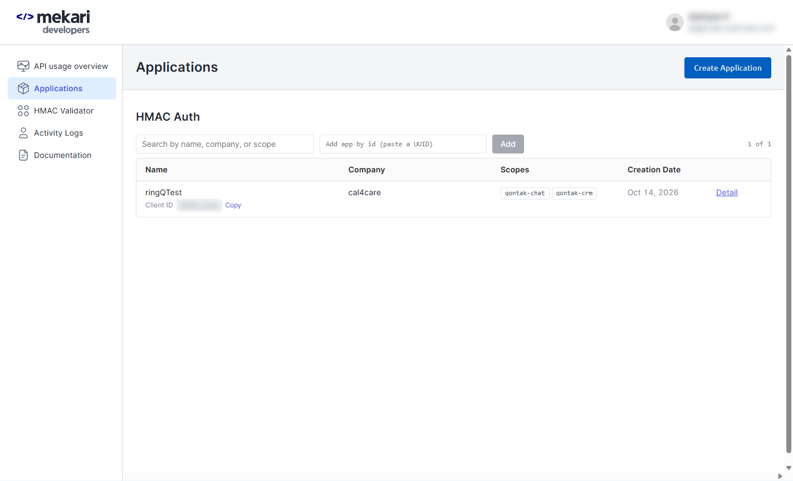

The **HMAC Auth** list shows the applications already created, with their **Client ID**, **Company** and **Scopes**. If an application for RingQ already exists with the `qontak-crm` scope (here **ringQTest**), you can reuse it: skip to Step A4.

If the company has no Qontak CRM API access yet, the company owner must request it from Mekari first. Without it, every request is refused with *lack permission (HTTP 403)*.

### Step A2. Create an HMAC application

Click **Create Application** (top right). Fill in:

| Field | Value |
|---|---|
| **Application Name** | `RingQ` |
| **Company** | Your Qontak company (here *cal4care*). The scopes load after you choose it. |
| **Authorized Scopes** | Click the **qontak-crm** filter, then tick **qontak-crm:all** (ticks every Qontak CRM scope) |

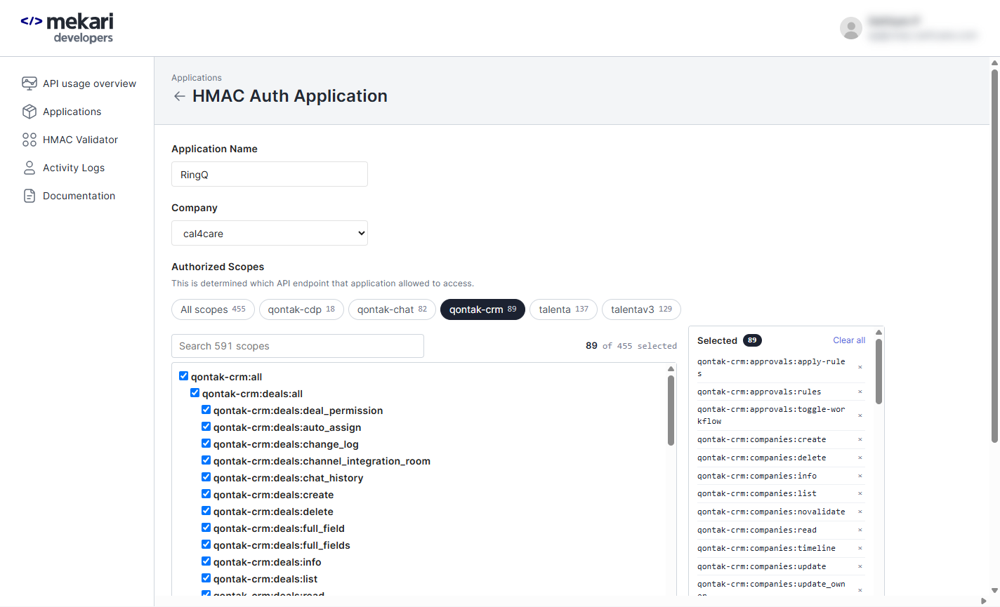

Scroll down and click **Submit**.

RingQ uses Qontak CRM contacts, tasks, task categories, companies and deals. `qontak-crm:all` covers all of them; the `qontak-chat`, `qontak-cdp` and `talenta` scopes are not needed.

### Step A3. Copy the Client Secret right away

After **Submit**, Mekari shows the **Client ID** and **Client Secret**. **Copy the Client Secret now**: later it is only shown masked.

### Step A4. Find the credentials again

Open **Applications** → your application's **Detail**.

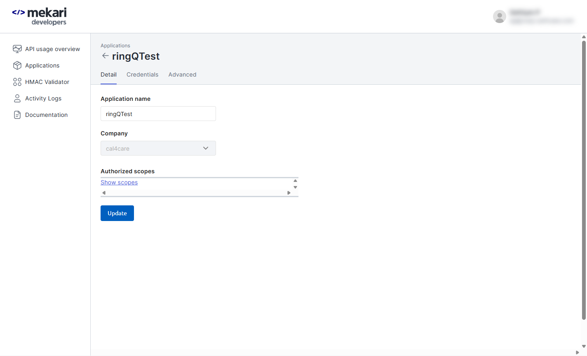

The **Credentials** tab shows the **Client ID** (with a copy button) and the **Client Secret** masked:

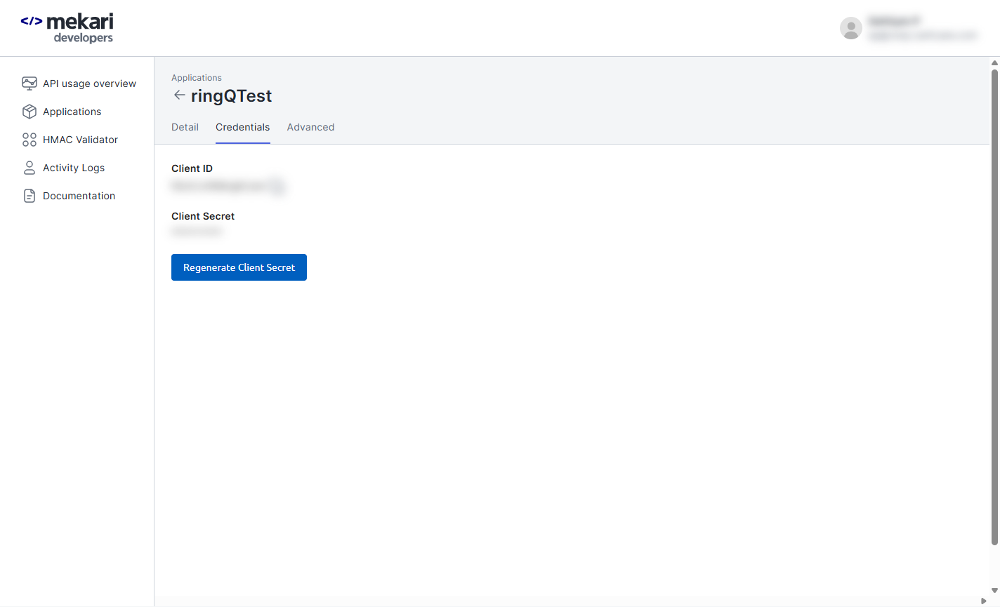

- **Client ID**: copy it here.
- **Client Secret**: if you no longer have it, click **Regenerate Client Secret**. The old secret stops working at once, so paste the new one into RingQ straight away (Step C3).

### Step A5. Optional: the acting user's SSO ID

RingQ can create contacts and tasks as a specific Qontak user. Its **SSO ID** is a UUID such as `50c3d284-7b8b-460d-88bf-9cdde2bdbc26`. Leave it empty unless Mekari or Qontak support gave it to you; tasks are then created as the application's default user.

| Credential | Goes into RingQ field |
|---|---|
| Client ID | **Client ID** |
| Client Secret | **Client Secret** |
| SSO ID (optional) | **Acting CRM user SSO ID** |

Keep the Client Secret private. If it is ever shared, regenerate it and enter the new one in RingQ.

---

## Part B. Install the RingQ side on the server (once per server)

Done by the RingQ server admin, as root. The Qontak files are part of this backend.

| Step | Command / action |
|---|---|
| B1. Deploy this backend's `app/` | To `/var/www/ringq/app/`. It includes `QontakController.php`, `app/library/Qontak/`, `QontakTask.php`, the access rules in `app/config/services.php` and the cron lines (`qontak sync`, `qontak prune`) in `app/tasks/tasks.txt`. |
| B2. Create the encryption key | See below. **Back up this file.** If it is lost, the Client Secret must be entered again. |
| B3. Create the tables | `sudo -u postgres psql -d ringq -v ON_ERROR_STOP=1 < app/scripts/qontak/2026_10_14_qontak_crm.sql` |
| B4. Reload PHP | `sudo systemctl reload php7.4-fpm` |
| B5. Check | `curl -s -o /dev/null -w '%{http_code}\n' https://<server>:8443/qontak/config` prints **401** |

```bash
sudo mkdir -p /etc/ringq
sudo sh -c 'head -c 32 /dev/urandom | base64 > /etc/ringq/qontak.key'
sudo chown root:www-data /etc/ringq/qontak.key
sudo chmod 0640 /etc/ringq/qontak.key
```

The key file stays on the server only; it is never in Git.

---

## Part C. Configure Qontak in RingQ

### Step C1. Open Global Settings → Integrations

Sign in to RingQ as an **admin**. In the left menu click **Global Settings**, then under **Tools** click **Integrations**.

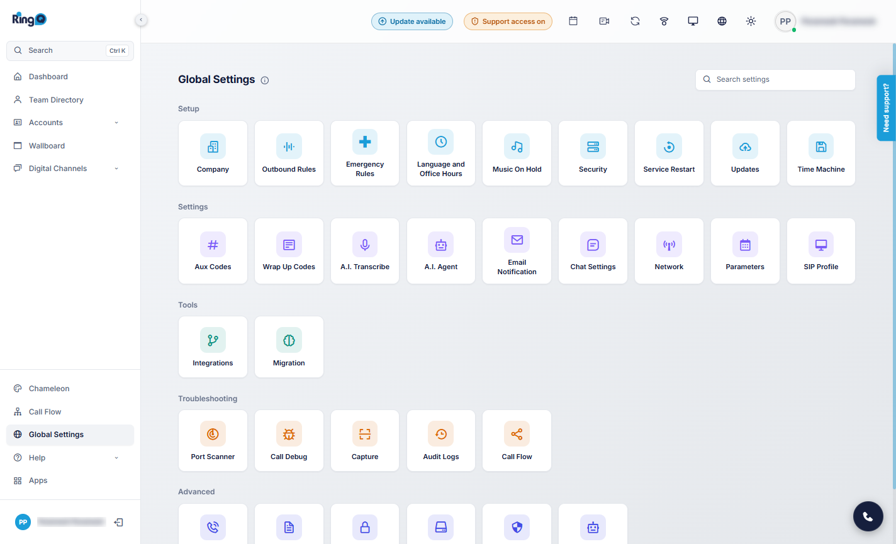

### Step C2. Open the Qontak card

On the **CRM** tab, click the **Qontak** card (or its **Configure** link). The card shows the status: Not configured, Enabled, Disabled or Connection error.

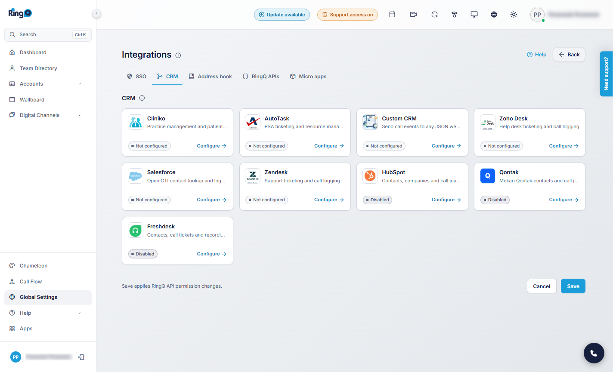

### Step C3. Enter the credentials and test

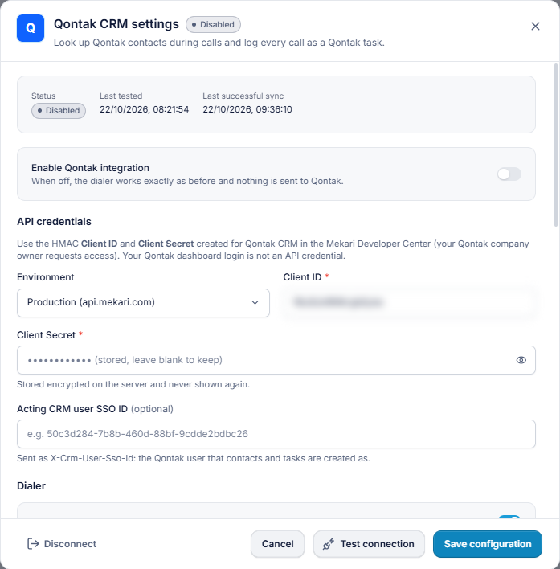

1. Switch **Enable Qontak integration** on.
2. **Environment:** **Production (api.mekari.com)** for your live Qontak; **Sandbox (api.mekari.io)** only with sandbox credentials.
3. **Client ID** and **Client Secret**: paste from Step A4.
4. **Acting CRM user SSO ID**: optional (Step A5).
5. Click **Test connection**. A green result means Qontak accepted the credentials.
6. Click **Save configuration**. **Status** changes to **Connected**.

After saving, the secret field shows `•••• (stored, leave blank to keep)`. Leave it blank when you change other settings.

### Step C4. Choose the call options

Scroll down in the same window.

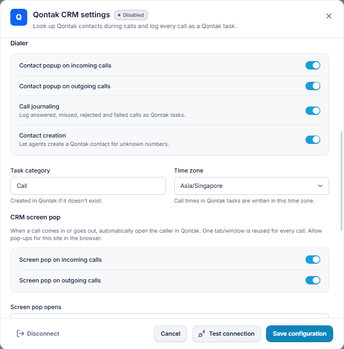

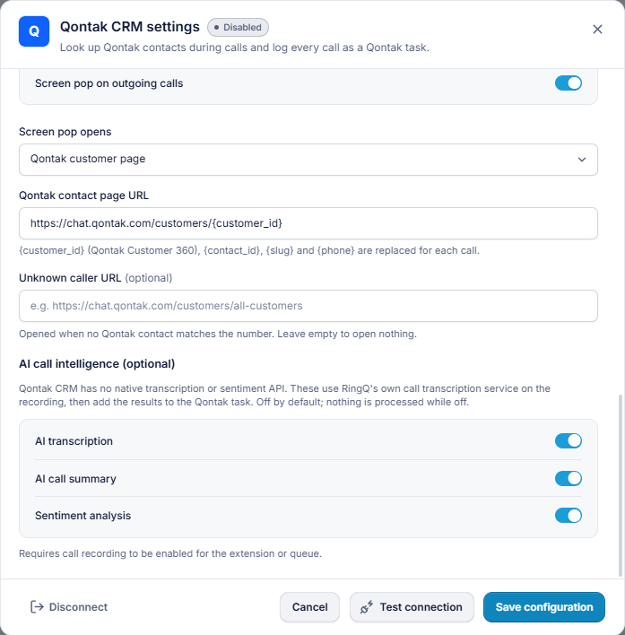

| Setting | Recommended | Notes |
|---|---|---|
| Contact popup on incoming / outgoing calls | On | Shows the Qontak contact in RingQ during calls |
| Call journaling | On | Every call becomes a Qontak task |
| Contact creation | On | Agents can create a contact for an unknown number |
| Task category | `Call` | Created in Qontak automatically if missing |
| Time zone | Your zone (e.g. `Asia/Jakarta`, `Asia/Singapore`) | Times written into tasks |
| Screen pop on incoming / outgoing calls | Your choice | Allow pop-ups for the RingQ site |
| Screen pop opens | This call's Qontak task, or the Qontak customer page | The customer page uses **Qontak contact page URL** (`https://chat.qontak.com/customers/{customer_id}`) |
| Unknown caller URL | Optional | Opened when no contact matches |
| AI transcription / summary / sentiment | Off | Optional; uses RingQ's own transcription service |

Click **Save configuration**.

---

## Part D. Test with a real call

1. Make sure a Qontak contact has your test phone number (`0812…`, `62812…` and `+62812…` all match).
2. Call the RingQ extension from that phone (or dial the number from RingQ).
3. While it rings, the RingQ popup shows the Qontak contact (name, phone, email, company, owner). The Qontak task is created right away with status *In Progress*.
4. Answer, talk a few seconds, hang up.
5. The popup shows **Qontak log: Synced — Call saved to Qontak with recording link**.

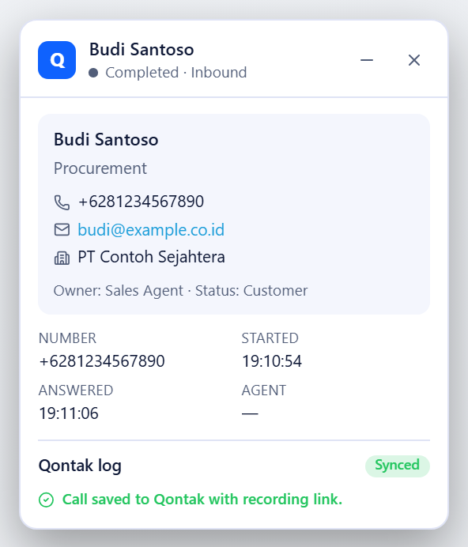

6. Check Qontak as shown in Part E.

If something is missing, see [Troubleshooting](../qontak/USER_GUIDE.md#8-troubleshooting).

---

## Part E. Where calls and recordings appear in Qontak

### E1. Tasks list

In Qontak open **Tasks** (left menu). Every RingQ call is a task:

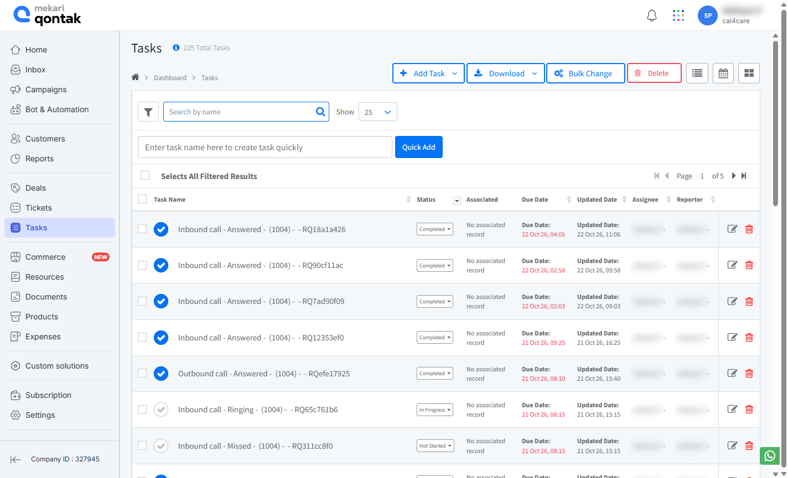

| Column | Content |
|---|---|
| Task Name | `Inbound call - Answered - <contact> (<number>) - <agent> - RQ…` |
| Status | **Completed** for answered calls; **In Progress** while ringing or live; **Not Started** for missed calls (a call-back to-do) |
| Associated | The contact (and its company and deal) when the number matched |
| Due Date | When the call ended |

Use **Search by name** with the call reference (`RQ…`) to find one call.

### E2. One call, with the recording link

Click a task. **Details / Plan** holds everything RingQ recorded:

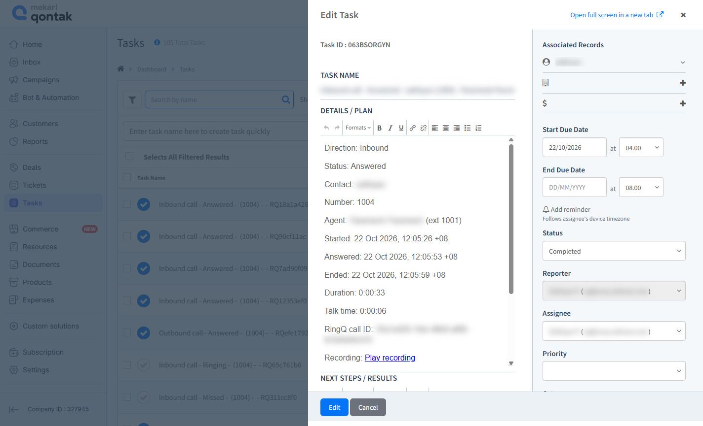

| Line | Content |
|---|---|
| Direction / Status | Inbound or Outbound; Answered, Missed… |
| Contact / Number | The Qontak contact and the number |
| Agent | The RingQ agent and extension |
| Started / Answered / Ended | Call times in the RingQ time zone setting |
| Duration / Talk time | Full call and talk time |
| RingQ call ID | The same ID as in RingQ Call Logs |
| **Recording** | **Play recording**: a signed RingQ link that plays the call. The address is also written as text below it, because Qontak's editor does not always make links clickable. |
| Transcription | Only when AI transcription is on |

Qontak cannot store audio through its API, so the recording stays on the RingQ server and the task holds the link. Links work until **Disconnect**.

---

## Part F. Change or remove the credentials

| Task | How |
|---|---|
| **New secret** (shared or leaked) | Mekari Developer Center → Applications → your app → **Credentials** → **Regenerate Client Secret**. Paste it in RingQ (Step C3) and save. |
| **Disconnect** | RingQ Qontak settings → **Disconnect**. Deletes the stored secret, stops logging and revokes recording links. Tasks already in Qontak stay. |
| **Remove completely** | Disconnect in RingQ, then delete the application in the Mekari Developer Center. |

---

## Checklist

- [ ] Qontak CRM API access enabled for the company (company owner)
- [ ] HMAC application with `qontak-crm:all`; Client ID and Client Secret copied
- [ ] Server: `/etc/ringq/qontak.key` created and backed up, tables created, PHP reloaded, `/qontak/config` answers 401
- [ ] RingQ: environment chosen, credentials entered, **Test connection** green, **Save configuration**, status **Connected**
- [ ] Test call appears in Qontak **Tasks** with a recording link
