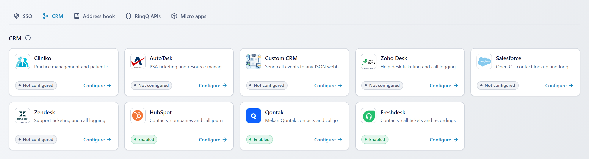

# CRM setup guides

Step-by-step setup for RingQ's three CRM integrations: which key each CRM needs, where to get it, how to install the RingQ side, how to configure it in RingQ (with screenshots of every settings screen), and how to test it with a call.

| CRM | Setup guide | Daily use |
|---|---|---|
| **HubSpot** | [HUBSPOT_SETUP.md](HUBSPOT_SETUP.md) | [hubspot/USER_GUIDE.md](../hubspot/USER_GUIDE.md) |
| **Qontak CRM** (Mekari) | [QONTAK_SETUP.md](QONTAK_SETUP.md) | [qontak/USER_GUIDE.md](../qontak/USER_GUIDE.md) |
| **Freshdesk** | [FRESHDESK_SETUP.md](FRESHDESK_SETUP.md) | [freshdesk/USER_GUIDE.md](../freshdesk/USER_GUIDE.md) |

Calls are made and answered in RingQ as usual. There is no dialer inside the CRMs: each CRM receives the contact lookup, the call record and the recording.

## Which key each CRM uses

| | HubSpot | Qontak CRM | Freshdesk |
|---|---|---|---|
| **Credential** | Private app **access token** | HMAC **Client ID** + **Client Secret** (+ optional **SSO ID**) | Help desk **address** + agent **API key** |
| **Looks like** | `pat-na1-…` | an ID and a long secret | `yourcompany.freshdesk.com` + a key (classic, or `fwapi_…`) |
| **Where to get it** | HubSpot → Settings → Integrations → **Private Apps** | **Mekari Developer Center** (developers.mekari.com) → HMAC application for Qontak CRM | Freshdesk → profile picture → **Profile settings** → **View API key** |
| **Who can create it** | HubSpot Super Admin | Qontak company owner | Any agent (use one who sees all tickets) |
| **Permissions** | Scopes `crm.objects.contacts.read`, `crm.objects.contacts.write` (+ `crm.objects.companies.read`) | Qontak CRM API access for the company | The agent's own rights |
| **RingQ fields** | Private app access token | Environment, Client ID, Client Secret, Acting CRM user SSO ID | Freshdesk address, API key |
| **Records created as** | The private app | The SSO ID user (or the default user) | The agent whose key it is |
| **Server extra** | nginx rule for recording links | Key file `/etc/ringq/qontak.key` | none (`install.sh` does everything) |
| **Rotate** | Private app → Auth → **Rotate** | New secret in the Developer Center | Reset the key in Profile settings |

None of them needs your CRM **password**. RingQ stores each credential **encrypted** on the server; it is never shown again in the browser (only the last 4 characters) and never written to logs.

## Where to configure in RingQ

All three: **Settings → Integrations → CRM** → the CRM's card → **Configure**. You must be a RingQ **admin**.

The card shows **Not configured**, **Enabled**, **Disabled** or **Connection error**.

## The same five parts in every guide

1. **Part A** — get the key in the CRM (click by click).
2. **Part B** — install the RingQ side on the server (once per server).
3. **Part C** — configure the CRM in RingQ (screenshots of each settings screen).
4. **Part D** — test with a real call and check the result in the CRM.
5. **Part E** — rotate the key, disconnect, or remove.

Screenshots show RingQ's own settings screens with sample data.

## Before you start (all CRMs)

| You need | For |
|---|---|
| Admin access to RingQ | Saving the CRM settings |
| Root access to the RingQ server | Part B, once |
| Call recording on the extension or queue | Recordings in the CRM |
| A test contact in the CRM with your phone number | Part D |

Technical details for all three (files, tables, cron, access rules): [CRM_INTEGRATIONS.md](../CRM_INTEGRATIONS.md).

## Micro apps

| App | Setup guide | Technical |
|---|---|---|
| **WhatsApp calling** (Meta SIP) | [WHATSAPP_SETUP.md](WHATSAPP_SETUP.md) — where to get the Meta access token, Phone number ID and other credentials | [whatsapp/TECHNICAL.md](../whatsapp/TECHNICAL.md) |
