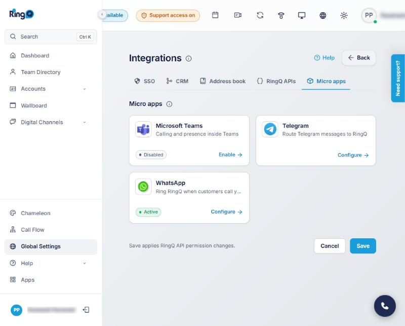
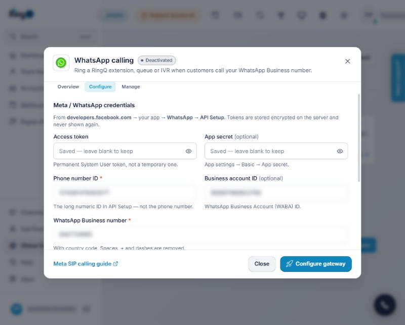
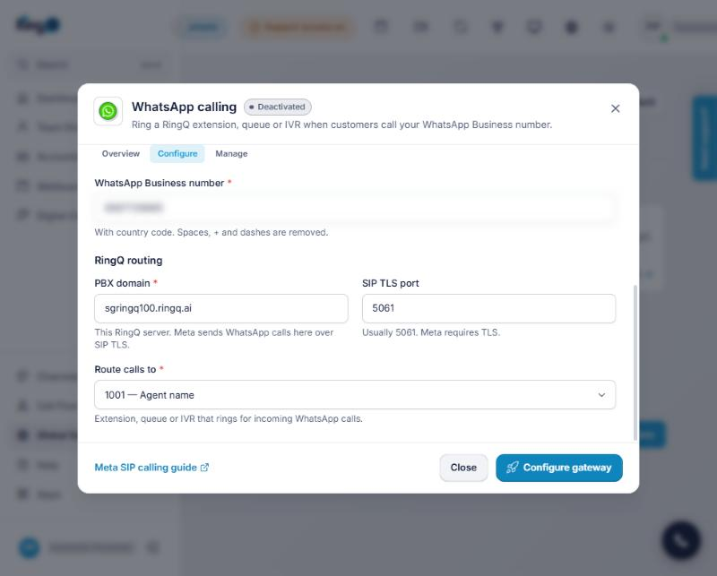
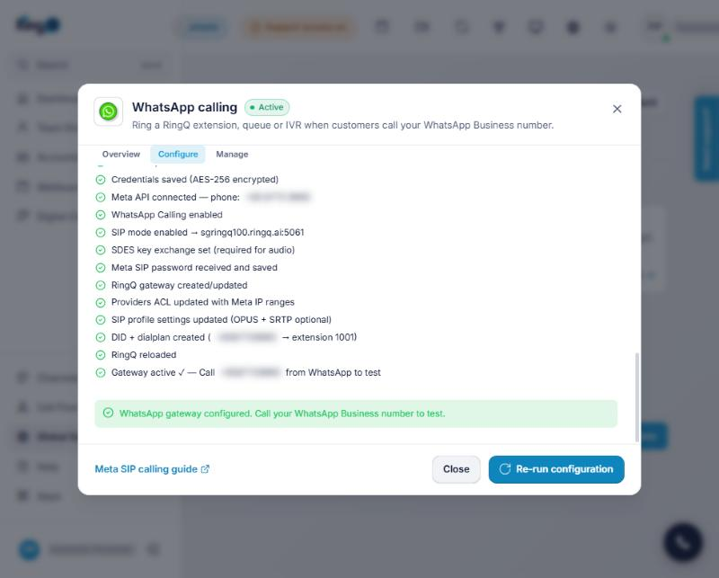
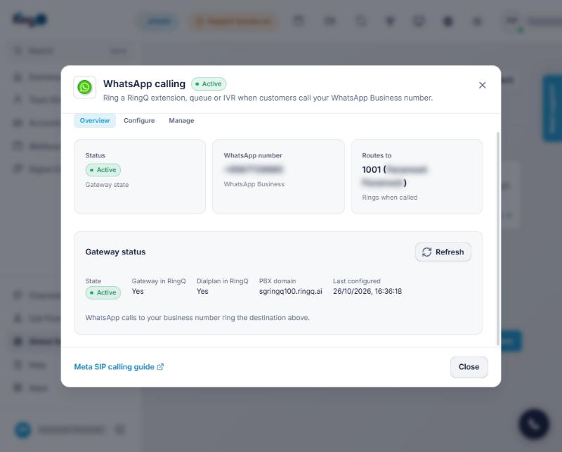
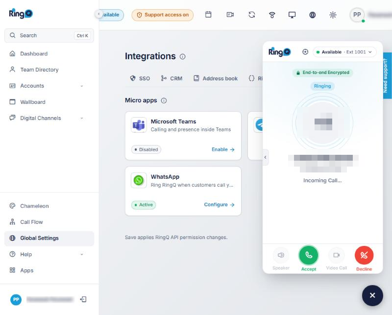
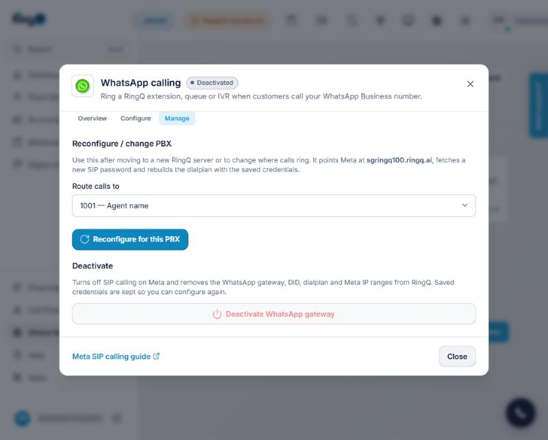
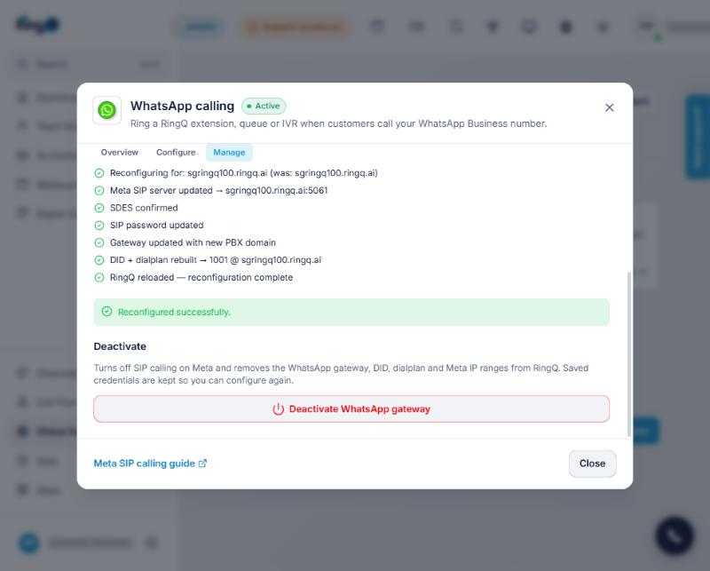

# RingQ + WhatsApp calling: complete setup guide

This guide connects a **WhatsApp Business number** to RingQ, so that when a customer taps the **call** button in WhatsApp, a RingQ extension, queue or IVR rings. It covers where to find every Meta credential, how to install the RingQ side, how to configure it in RingQ (with screenshots of every RingQ screen), and what the incoming WhatsApp call looks like in the RingQ dialer.

**Contents:** [Before you start](#before-you-start) · [Part A. Meta credentials](#part-a-get-the-credentials-from-meta) · [Part B. Server install](#part-b-install-the-ringq-side-on-the-server-once-per-server) · [Part C. Configure in RingQ](#part-c-configure-whatsapp-in-ringq) · [Part D. Test call](#part-d-test-with-a-real-call) · [Part E. Change or remove](#part-e-change-move-or-remove) · [Troubleshooting](#troubleshooting) · [Checklist](#checklist)

| | |
|---|---|
| **What you need** | A Meta **app** with WhatsApp, a **permanent access token**, the **Phone number ID**, the **WhatsApp Business number** (and optionally the **App secret** and **WhatsApp Business Account ID**) |
| **Who gets them** | An admin of the company's **Meta Business portfolio** (business.facebook.com) |
| **Where they go in RingQ** | Settings → Integrations → **Micro apps** → **WhatsApp** → **Configure** |
| **Not needed** | Your Facebook password, a SIP password (Meta generates it and RingQ fetches it), any WhatsApp Business app on a phone |
| **Time** | About 20 minutes (plus Meta's business verification if it is not done yet) |

How it works: RingQ calls the Meta Graph API to turn on **WhatsApp Calling** in **SIP mode** for your number, pointing Meta at your RingQ server (`your-server.ringq.ai:5061`, TLS). RingQ then creates a SIP gateway, allows Meta's IP ranges, and creates an inbound route (DID) for the WhatsApp number that rings the destination you pick.

---

## Before you start

| You need | Why |
|---|---|
| A **Meta Business portfolio** (business.facebook.com), ideally **verified** | Permanent tokens and production calling need it |
| A **WhatsApp Business Platform (Cloud API)** number that is **registered and connected** — not the WhatsApp Business *app* on a phone, and not Meta's free **test number** | Calling only works on a real Cloud API number |
| WhatsApp **Calling** available for your number's country and account | Meta enables the Calling API per country and account; check the Meta Calling API documentation |
| RingQ server reachable from the internet on **TCP 5061 (SIP TLS)** with a **valid certificate** for its FQDN | Meta only connects over TLS to a trusted certificate |
| RingQ **admin** access | Saving the configuration |

---

## Part A. Get the credentials from Meta

Keep a text file open and copy each value into it as you go.

### Step A1. Create (or open) the Meta app

1. Go to **https://developers.facebook.com** → **My Apps**.
2. Open your existing WhatsApp app, or click **Create app**:
   - Use case: **Other** → app type **Business**.
   - Pick your **Business portfolio**.
3. In the app dashboard, find **WhatsApp** and click **Set up** (skip if WhatsApp is already in the left menu).

### Step A2. Phone number ID and WhatsApp Business Account ID

1. In the app, left menu → **WhatsApp** → **API Setup**.
2. In **Send and receive messages** → **From**, select your **real business number** (add it with **Add phone number** if it is not listed, and finish its verification by SMS or voice).
3. Under the number, copy:
   - **Phone number ID** — a long number like `123456789012345`. This is **not** the phone number.
   - **WhatsApp Business Account ID** — a long number like `987654321098765`.

> The **temporary access token** shown on this page expires after **24 hours**. Do not use it in RingQ; create a permanent one in Step A4.

### Step A3. WhatsApp Business number

The number itself, **with country code, digits only**, for example `6512345678` for +65 1234 5678. It is shown at the top of **API Setup** and in **WhatsApp Manager → Phone numbers**.

### Step A4. Permanent access token (System User)

1. Go to **https://business.facebook.com** → **Settings** (Business settings).
2. **Users** → **System users** → **Add**.
   - Name: e.g. `RingQ WhatsApp`. Role: **Admin**. Click **Create system user**.
3. With the system user selected, click **Assign assets**:
   - **Apps** → your app → turn on **Full control (Manage app)**.
   - **WhatsApp accounts** → your WhatsApp Business Account → turn on **Full control**.
   - Click **Save changes**.
4. Click **Generate new token**:
   - App: your app.
   - Token expiration: **Never**.
   - Permissions: tick **`whatsapp_business_management`** and **`whatsapp_business_messaging`**.
   - Click **Generate token** and **copy it now** — Meta shows it only once. It starts with `EAA…`.

### Step A5. App secret (optional)

1. developers.facebook.com → your app → **App settings** → **Basic**.
2. **App secret** → **Show** (enter your Facebook password if asked) → copy the 32-character value.

RingQ stores it for webhook signature checks; calling works without it.

### Summary: what goes where

| Meta value | Where in Meta | RingQ field |
|---|---|---|
| Permanent token `EAA…` | Business settings → System users → Generate new token | **Access token** |
| App secret | App → App settings → Basic | **App secret** (optional) |
| Phone number ID | App → WhatsApp → API Setup | **Phone number ID** |
| WhatsApp Business Account ID | App → WhatsApp → API Setup | **Business account ID** (optional) |
| Business phone number | API Setup / WhatsApp Manager | **WhatsApp Business number** |

---

## Part B. Install the RingQ side on the server (once per server)

1. Copy `app/controllers/WasipController.php` to the server.
2. In `app/config/services.php`, inside the `$privately` list (the `registered` role), add:

   ```php
   "wasip" => ["health", "destinations", "load", "status", "configure", "reconfigure", "deactivate"]
   ```

   Without this line every `/wasip/*` call returns **403 "Sorry, this is not available. (Code AC4031)"**.
3. Create or upgrade the table:

   ```bash
   psql -U <owner> -d ringq -v ON_ERROR_STOP=1 -f app/scripts/wasip/2026_10_23_wasip.sql
   ```

4. Set the encryption key for stored tokens (once; keep it the same afterwards, or saved tokens cannot be read):

   ```bash
   # PHP-FPM pool config, e.g. /etc/php/8.x/fpm/pool.d/www.conf
   env[WASIP_ENC_KEY] = <a long random string>
   ```

5. Check and reload PHP:

   ```bash
   php -l app/config/services.php && php -l app/controllers/WasipController.php
   sudo systemctl reload php*-fpm
   ```

6. Open firewall **TCP 5061** to Meta (RingQ adds Meta's IP ranges to the `providers` ACL itself when you configure).

---

## Part C. Configure WhatsApp in RingQ

Screenshots in this part are from a live RingQ server. Phone numbers, IDs and names are blurred.

### Step C1. Open the WhatsApp card

Sign in to RingQ as an admin. In the left menu click **Global Settings**, then under **Tools** click **Integrations**, and open the **Micro apps** tab.


Click the **WhatsApp** card (next to Telegram). The card shows **Not configured**, **Active**, **Configured**, **Failed** or **Deactivated**.



The **WhatsApp calling** window has three tabs: **Overview** (status), **Configure** (credentials and routing) and **Manage** (reconfigure or deactivate).

### Step C2. Enter the Meta credentials

Open the **Configure** tab.



| Field | Value |
|---|---|
| Access token | The permanent `EAA…` token (Step A4). Once saved it shows *Saved — leave blank to keep*. |
| App secret | Optional (Step A5) |
| Phone number ID | Step A2 (the long ID, **not** the phone number) |
| Business account ID | Optional (Step A2) |
| WhatsApp Business number | Step A3, with country code |

### Step C3. Choose where calls ring

Scroll down to **RingQ routing**.



| Field | Value |
|---|---|
| PBX domain | Filled in with this server's FQDN (e.g. `your-server.ringq.ai`); leave it |
| SIP TLS port | `5061` |
| Route calls to | The **extension**, **queue** or **IVR** that should ring for WhatsApp calls |

### Step C4. Configure the gateway

Click **Configure gateway**. RingQ shows each step as it runs (about 30–60 seconds):



Every line must have a green tick, ending with **Gateway active ✓** and *WhatsApp gateway configured. Call your WhatsApp Business number to test.* A red line shows Meta's message; see [Troubleshooting](#troubleshooting).

Tokens are never shown again. To keep the saved token when re-running, leave **Access token** blank and click **Re-run configuration**.

### Step C5. Check the status

Open the **Overview** tab and click **Refresh**.



| Field | Must show |
|---|---|
| Status / State | **Active** |
| Routes to | The extension, queue or IVR from Step C3 |
| Gateway in RingQ | **Yes** |
| Dialplan in RingQ | **Yes** |
| PBX domain | This server |

If **Gateway in RingQ** shows **No**, open **Configure** and click **Re-run configuration** (Step C4).

**Allow a few minutes.** After configuring (or re-running), Meta can take several minutes before it starts sending calls to the server. A test call made straight away may not reach RingQ; wait 5 minutes and call again.

---

## Part D. Test with a real call

1. On a phone with WhatsApp, open a chat with your business number.
2. Tap the **call** icon. (If there is no call icon, calling is not enabled for the number yet — check Step C4 succeeded, and that Calling is available for your country.)
3. The destination you chose rings in RingQ. In the RingQ web app, the dialer opens with **Ringing · Incoming Call…** and the caller's WhatsApp number, with **Accept** and **Decline**:

   

   Desk phones and the RingQ mobile app on the same extension ring too. The caller ID is the customer's WhatsApp number (shown as `WA: <number>` on phones that display the caller name).
4. Click **Accept** and check two-way audio. Allow microphone access in the browser when asked.
5. After the call it appears in **Recents** and **Call Logs** like any other inbound call.

If nothing rings, see [Troubleshooting](#troubleshooting). Remember the few-minute delay after configuring (Step C5).

---

## Part E. Change, move or remove



**Reconfigure for this PBX** shows its own steps and *Reconfigured successfully*:



| Task | Where |
|---|---|
| Ring a different extension / queue / IVR | **Manage** → **Route calls to** → **Reconfigure for this PBX** (no new token needed) |
| Moved RingQ to a new server or FQDN | Open RingQ on the **new** server → **Manage** → **Reconfigure for this PBX** |
| New token (old one revoked) | **Configure** → paste the new token → **Re-run configuration** |
| Stop WhatsApp calls | **Manage** → **Deactivate WhatsApp gateway** (credentials are kept) |

---

## Troubleshooting

| Message | Cause and fix |
|---|---|
| `Sorry, this is not available. (Code AC4031)` | `wasip` missing from `$privately` in `services.php`, or PHP not reloaded (Part B) |
| `Unauthorized (Code AI1001)` | Not signed in to RingQ |
| `Cannot connect to Meta API — check Access Token` | Token wrong, expired (a 24-hour temporary token), or missing the two WhatsApp permissions |
| `Meta API: … not allowed / not enabled for calling` | Calling not available for this number or country, or the number is the test number |
| `Meta did not return SIP password — wait 30s and retry` | Meta needs a moment after enabling SIP; click **Re-run configuration** |
| Route calls to says *No destinations found* | No extensions, queues or IVRs in this tenant, or the `/wasip/load` call failed (the reason is shown in red) |
| Card stays **Failed** | Open **Configure**; the failed step is marked in red with Meta's message |
| Overview shows **Gateway in RingQ: No** after **Reconfigure** | Reconfigure only updates an existing gateway. After a **Deactivate**, use **Configure → Re-run configuration** to create it again |
| Test call made right after configuring does not ring | Meta needs a few minutes to start sending calls; wait 5 minutes and call again |
| Dashboard shows the `watrunk_…` trunk red / log shows `Failed Registration [403]` to `wa.meta.vc` | Normal for incoming WhatsApp calls: Meta sends calls to RingQ without this registration. Calls still ring if the gateway is Active |
| WhatsApp shows the call but RingQ never rings | TCP 5061 blocked, or the server certificate is not valid for the FQDN |
| Call connects with no audio | SDES not set (re-run configuration), or RTP ports blocked in the firewall |

---

## Checklist

- [ ] Real Cloud API number, verified, Calling available
- [ ] Permanent System User token with `whatsapp_business_management` + `whatsapp_business_messaging`
- [ ] Phone number ID (not the phone number) copied
- [ ] `wasip` added to `$privately`, SQL run, `WASIP_ENC_KEY` set, PHP reloaded
- [ ] TCP 5061 open with a valid certificate
- [ ] Configure gateway → **Active**
- [ ] Test call from WhatsApp rings the chosen destination

Technical details: [whatsapp/TECHNICAL.md](../whatsapp/TECHNICAL.md).
