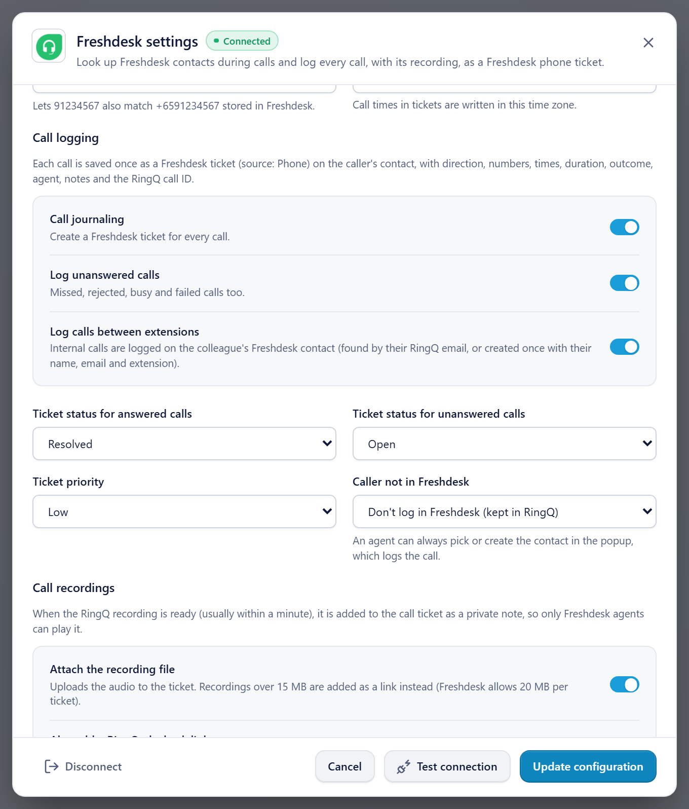
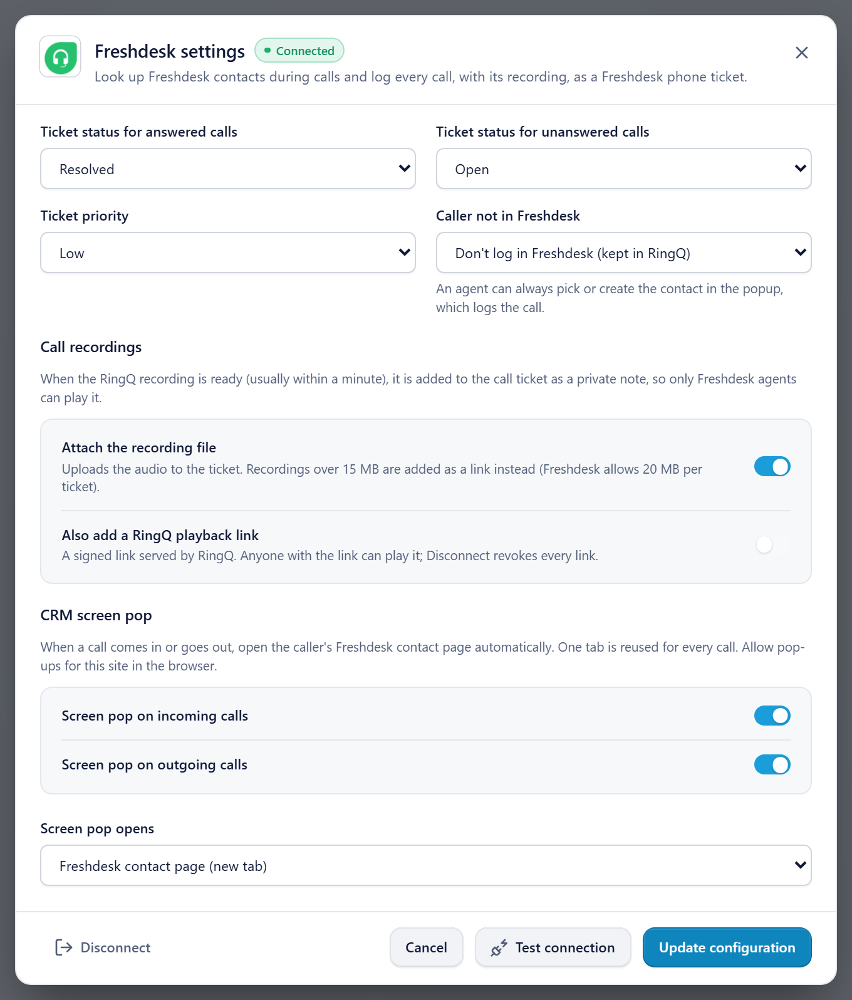
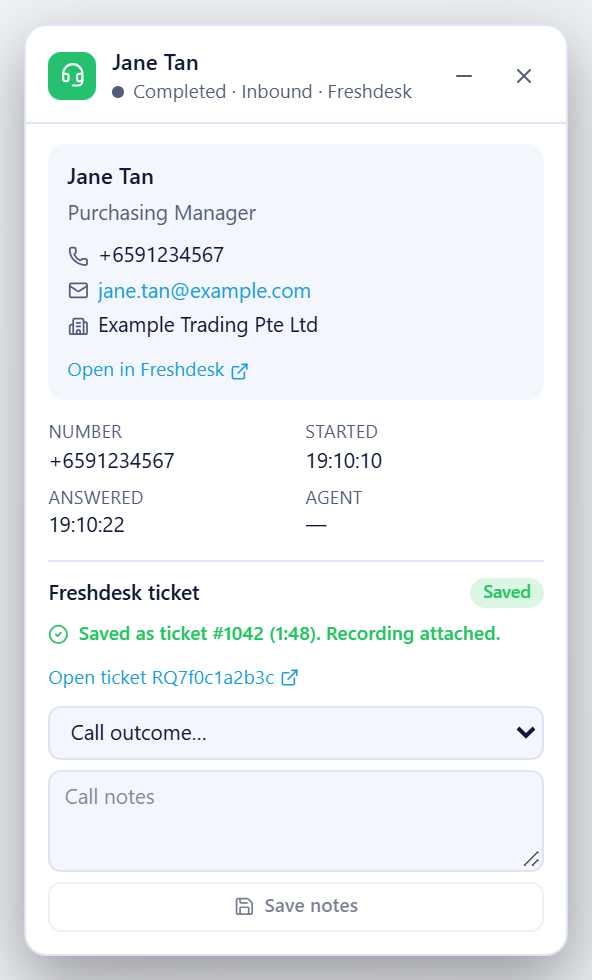

# RingQ + Freshdesk: setup and user guide

This guide covers everything needed to connect RingQ to Freshdesk:

1. [What the integration does](#1-what-the-integration-does)
2. [Before you start](#2-before-you-start)
3. [Sign in to Freshdesk and find the help desk address](#3-sign-in-to-freshdesk-and-find-the-help-desk-address)
4. [Get the Freshdesk API key](#4-get-the-freshdesk-api-key)
5. [Install the RingQ side on the server (RingQ admin)](#5-install-the-ringq-side-on-the-server-ringq-admin)
6. [Configure Freshdesk in RingQ](#6-configure-freshdesk-in-ringq)
7. [Put the RingQ dialer inside Freshdesk](#7-put-the-ringq-dialer-inside-freshdesk)
8. [Making and taking calls](#8-making-and-taking-calls)
9. [Where call details and recordings appear](#9-where-call-details-and-recordings-appear)
10. [Troubleshooting](#10-troubleshooting)
11. [Reference: files, data and security](#11-reference-files-data-and-security)

---

## 1. What the integration does

Freshdesk is a **help desk**. It has contacts and tickets, but no "call" record in its API. So RingQ logs every call as **one ticket with the source "Phone"** on the caller's contact.

| When | What happens |
|---|---|
| A call rings or starts | RingQ finds the caller's Freshdesk contact by phone number. The contact page opens in Freshdesk (or a new browser tab), and a small RingQ popup shows the contact and the call. |
| Inside Freshdesk | The **RingQ dialer** sits in Freshdesk's phone sidebar. Clicking any phone number in Freshdesk calls it from the agent's RingQ extension. Incoming calls ring there with **Answer / Decline**. |
| The call ends | RingQ creates **one Phone ticket** on the contact. It holds direction, numbers, times, duration, talk time, outcome, agent and extension, and the RingQ call ID. |
| About a minute later | The **call recording** is added to that ticket as a **private note** with the audio file attached. Only Freshdesk agents can see private notes. |
| The agent adds notes | Notes and an outcome (disposition) typed in the RingQ popup or dialer are saved on the same ticket. |

Calls between two RingQ extensions (internal calls) are logged too, on the colleague's Freshdesk contact (section 8.4).

Nothing changes in RingQ's normal calling. If Freshdesk is slow, offline or switched off, calls work exactly as before.

---

## 2. Before you start

| You need | Notes |
|---|---|
| A Freshdesk account that allows **custom apps** | Needed only for the dialer **inside** Freshdesk (section 7). Freshdesk Pro, Enterprise and Omni plans qualify (trials too). Call logging and the RingQ popup work on any paid plan with API access. |
| A Freshdesk **agent** whose API key RingQ will use | Tickets are created **as this agent**. Use an agent who can view and create contacts and tickets for all customers. |
| **Admin** access to Freshdesk | To install the app and switch off Freshdesk's built-in phone (Freshcaller). |
| **Admin** access to RingQ | To save the Freshdesk settings (plain users can only view them). |
| Root access to the RingQ server | Once, to install the backend (section 5). |
| Each agent: a RingQ **extension** and a microphone | Calls go out from the agent's own extension. |

---

## 3. Sign in to Freshdesk and find the help desk address

RingQ needs the help desk's own address, **`yourcompany.freshdesk.com`**.

1. Open your browser and sign in to Freshworks/Freshdesk with your normal Freshdesk email and password.
   - Newer Freshworks accounts sign in at an address like **`yourcompany.myfreshworks.com`**. That is only the **sign-in** page. It is **not** the help desk address, and the Freshdesk API does not work on it.
2. After signing in, open the **help desk** itself (Tickets or Contacts).
3. Copy the host name from the browser's address bar. It looks like:

   ```
   https://corpcal4care.freshdesk.com/a/tickets
           └──────── this part ───────┘
   ```

   For the Cal4Care account the address is **`corpcal4care.freshdesk.com`**. (`cal4care.freshdesk.com` does not exist; Freshdesk shows "We couldn't find…".)

RingQ never needs or stores your Freshdesk password.

---

## 4. Get the Freshdesk API key

The API key is how RingQ talks to Freshdesk. Each agent has one.

1. In Freshdesk, sign in as the agent RingQ should create tickets as (section 2).
2. Click your **profile picture** (top right) → **Profile settings**.
3. On the right, click **View API key**, and complete the check if Freshdesk asks for one.
4. Copy the key.
   - Classic keys are a short string of letters and digits.
   - Newer Freshworks accounts show a key that starts with **`fwapi_`**. That works too.

Keep the key secret. Anyone with it can act as that agent in Freshdesk. If it is ever shared (chat, email, screenshot), open the same page and **reset** it, then enter the new key in RingQ (section 6).

---

## 5. Install the RingQ side on the server (RingQ admin)

This is done **once per RingQ server**. It adds new files only; no existing RingQ file is changed.

### 5.1 Backend (API)

The installer is `freshdesk/install.sh` in this repository (RINGQ_CRMS_BACKEND).

On the RingQ server, as root, from a checkout (or copy) of this repository:

```bash
sudo bash freshdesk/install.sh
```

The defaults are app root `/var/www/ringq` and database `ringq`. To change them:

```bash
sudo APP=/var/www/ringq DB=ringq DB_USER=<app_db_user> bash freshdesk/install.sh
```

What it does (each step is safe to run again):

1. Copies the Freshdesk PHP files into `/var/www/ringq/app/` (controller, library, background task) and checks their syntax.
2. Creates three new database tables: `q_freshdesk_config`, `q_freshdesk_call_journals`, `q_freshdesk_cti_tokens`. Your existing tables are not touched.
3. Writes the background job to **`/etc/cron.d/ringq-freshdesk`** (every minute). It does not use root's crontab, because RingQ's `app/scripts/jobs.sh` rebuilds that.
4. Reloads PHP-FPM.
5. Checks that `https://<server>:8443/freshdeskcrm/config` answers **401** (installed, needs a login). A **404** means the API is not running these files.

No ionCube encoding and no `services.php` change are needed: the Freshdesk controller registers its own access rules.

### 5.2 Dialer page

The RingQ dialer that runs inside Freshdesk is a small web page. Build it on a PC with the frontend repository:

```bash
npx vite build --config vite.freshdeskcti.config.js
```

Copy these files from `dist-freshdeskcti/` to **`/var/www/webapp/click2call/freshdesk/`** on the server (next to the HubSpot dialer's `hubspot/` folder):

- `index.html`, `connect.html`
- `assets/` (all files)
- `sounds/ringtone.mp3`, `sounds/ringtone.wav`
- `images/favicon.png`

Check it in a browser: `https://<server>/click2call/freshdesk/` should show **RingQ for Freshdesk – Connect RingQ**. The page must be served **without** an `X-Frame-Options` header (the same as `/click2call/hubspot/`), or Freshdesk cannot show it.

---

## 6. Configure Freshdesk in RingQ

In RingQ, as an admin: **Settings → Integrations → CRM → Freshdesk → Configure**.


*Settings → Integrations → CRM. The Freshdesk card shows Not configured, Enabled, Disabled or Connection error. Click **Configure**.*

### 6.1 Account


*Top of the Freshdesk settings: status (account, the agent tickets are created as, last test and sync), the **Enable** switch, the **Freshdesk address** and the **API key** (shown masked once stored). Screenshots use sample data.*

| Field | What to enter |
|---|---|
| **Enable Freshdesk integration** | On. When off, nothing is sent to Freshdesk. |
| **Freshdesk address** | The help desk address from section 3, e.g. `corpcal4care.freshdesk.com`. You can paste the full URL; RingQ keeps only the host. |
| **API key** | The key from section 4. After saving, the field shows only `••••` and the last 4 characters. Leave it blank to keep the stored key. |

Click **Save configuration**. RingQ tests the connection straight away. The status should change to **Connected**, with:

- **Account**: your Freshdesk account name (e.g. CAL4CARE).
- **Tickets created as**: the agent whose key you entered.

Use **Test connection** at any time; it does not save anything. **Disconnect** deletes the stored key, stops logging, signs out every Freshdesk dialer and disables recording links. Tickets already in Freshdesk are kept.

### 6.2 All settings



*Call logging (journaling, unanswered calls, calls between extensions), ticket status and priority, what to do with callers not in Freshdesk, and recordings.*



*Recordings (attach the file, optional playback link) and the CRM screen pop.*

| Setting | Default | What it does |
|---|---|---|
| Contact popup on incoming / outgoing calls | On | Shows the RingQ popup with the caller's Freshdesk contact during calls in the RingQ app. |
| Contact creation | Off | Lets agents create a Freshdesk contact for an unknown number from the popup. |
| **Country calling code** | empty | **Set this** (e.g. `91` for India, `65` for Singapore). It lets `9876543210` match `+919876543210` stored in Freshdesk, and the other way round. |
| **Time zone** | your PC's zone | Times written into tickets. If it shows `UTC`, change it to your zone (e.g. `Asia/Kolkata`). |
| Call journaling | On | Creates a Freshdesk ticket for every call. |
| Log unanswered calls | On | Missed, rejected, busy and failed calls get a ticket too. |
| Log calls between extensions | On | Internal calls are logged on the colleague's contact (section 8.4). |
| Ticket status for answered calls | Resolved | Status of the call ticket. |
| Ticket status for unanswered calls | Open | So someone calls back. |
| Ticket priority | Low | |
| Caller not in Freshdesk | Don't log in Freshdesk | `Don't log`: the call is kept in RingQ; the agent can pick or create the contact in the popup to log it. `Create a contact, then log the call`: an unknown number gets a new contact named "Caller +91…". |
| Attach the recording file | On | Uploads the recording to the ticket (private note). Files over 15 MB are linked instead (Freshdesk allows 20 MB per ticket). |
| Also add a RingQ playback link | Off | Adds a signed link that plays the recording from the RingQ server. Anyone with the link can play it; Disconnect revokes all links. |
| Screen pop on incoming / outgoing calls | Off | Opens the caller's Freshdesk contact page automatically in a new tab (from the RingQ app). Allow pop-ups for the RingQ site. |
| Screen pop opens | Freshdesk contact page | Or a separate RingQ call-details window. |

If Freshdesk marks some **ticket fields as required**, the settings show a warning. RingQ cannot fill custom fields. If Freshdesk refuses to create a call ticket as Resolved, RingQ creates it as Open. A field that is required for every ticket must be made optional for agents in Freshdesk (Admin → Ticket fields).

---

## 7. Put the RingQ dialer inside Freshdesk

Freshdesk shows a third-party dialer only from an installed **app**, in its **phone (CTI) sidebar**.

### 7.1 Switch off Freshdesk's built-in phone (Freshcaller)

Freshdesk runs **only one** phone integration at a time. While **Freshcaller** is active (you see **Go to Powerdialer** in Freshdesk, or a Freshcaller phone widget), Freshdesk ignores the RingQ app.

As a Freshdesk admin: **Admin → Channels → Phone** (or the Freshcaller admin), and turn the phone channel **off** for this help desk. Then reload Freshdesk.

### 7.2 Upload and install the RingQ app

The app is in the frontend repository, folder `freshdesk-app/`. A packed copy is made with the Freshworks CLI (FDK):

1. Install FDK 10 (needs **Node.js 24.11.x exactly**):

   ```bash
   npm install https://cdn.freshdev.io/fdk/latest-v24.tgz -g
   ```

2. In `freshdesk-app/`:

   ```bash
   fdk validate
   fdk pack --skip-coverage
   ```

   This creates `dist/freshdesk-app.zip`. `--skip-coverage` is FDK's option for private custom apps; marketplace apps need test coverage.
3. In the **Freshworks developer portal**: **New app → Custom app**, and upload the zip.
4. In Freshdesk: **Admin → Apps → Custom apps → RingQ → Install**. When asked for **RingQ server address**, enter your RingQ host without `https://` or a port, e.g. **`sgringq100.ringq.ai`**.

### 7.3 Each agent, once

1. In Freshdesk, click the **phone icon** in the sidebar. The panel shows **RingQ for Freshdesk**.
2. Click **Connect RingQ**. A RingQ window opens. Sign in to RingQ there if asked, then click **Connect**. The window closes by itself.
3. Allow the **microphone** when the browser asks.
4. Leave **Receive calls in Freshdesk** on, to take incoming calls in Freshdesk.

The connection lasts 30 days. **Disconnect** (top of the dialer) signs it out.

If the dialer says the microphone is blocked, click **Open the dialer in its own window**. That window is a normal RingQ page with microphone access; click-to-call in Freshdesk keeps working and sends numbers to it.

---

## 8. Making and taking calls

### 8.1 Incoming call

1. The call rings **in Freshdesk's phone sidebar** (Answer / Decline) and **in the RingQ app** at the same time.
2. Freshdesk opens the **caller's contact page** when exactly one contact has that number.
3. In the RingQ app, the **RingQ popup** shows the contact (name, phone, email, company) and the call.
4. Answer **in either place**. The other one stops ringing. The call is logged **once**.

### 8.2 Outgoing call

- **From Freshdesk:** open a contact or ticket and **click the phone number**. The RingQ dialer opens and the call goes out from your extension.
- **From the RingQ app / dialer:** dial as usual. The popup shows the Freshdesk contact for that number.

During the call: mute, keypad (for menus) and hang-up are in the dialer.

### 8.3 After the call

The dialer (and the RingQ popup) shows the result:

- **Saved as ticket #…**, then **with recording** once the recording is attached (usually within a minute).
- **Call outcome** (e.g. Resolved, Follow-up needed, Callback requested, Left voicemail) and **Call notes**. Click **Save notes**. They are added to the same ticket as a private note.
- **Open ticket in Freshdesk** opens the call's ticket.

### 8.4 Internal calls (between extensions)

A call between two RingQ extensions (e.g. 1004 → 1001) is logged on the **colleague's** Freshdesk contact:

- RingQ looks up the RingQ user behind the other extension (their name and email).
- It uses the Freshdesk contact with that email. If there is none, it creates one **once**, with their name, email, and the Freshdesk "Unique external ID" `ringq-ext-<extension>` (e.g. `ringq-ext-1004`).
- The ticket says "Inbound call from Sathiyan developer (ext 1004)", the caller is "Extension 1004", and it is tagged `internal-call`.

Switch this off with **Log calls between extensions** (section 6.2).

### 8.5 Unknown callers and shared numbers

- **No contact has the number:** the popup says so. Depending on **Caller not in Freshdesk** (section 6.2) the call is kept in RingQ only, or a contact is created. The agent can always **pick or create** the contact in the popup or dialer after the call, and the call is then logged on it.
- **Several contacts share the number:** RingQ never guesses. The popup lists them; the call is logged once the agent picks one.

### 8.6 One call, one ticket

A call that rings on several devices of the same agent (RingQ app in two tabs, a desk phone, the Freshdesk dialer) creates **one** ticket: the answered copy wins; a missed call is logged once. Retried or repeated events never create a second ticket.

---

## 9. Where call details and recordings appear

### 9.1 In Freshdesk

Open the contact (**Contacts → the contact**) or **Tickets**, filter by tag `ringq-call` if needed.

**The call ticket**

| Part | Content |
|---|---|
| Subject | e.g. `Inbound call from Jane Tan (+6591234567) - Answered 1:05 - RQ0c3d33ea93` |
| Source | **Phone** |
| Status / priority | From the settings (answered: Resolved; unanswered: Open) |
| Requester | The caller's contact |
| Tags | `RingQ`, `ringq-call`, the call reference (e.g. `rq0c3d33ea93`), `inbound-call` / `outbound-call`, `internal-call` for internal calls |
| Description | Direction · Call status · Disposition · Caller number · Recipient number · Contact · Agent (name and extension) · Started · Answered · Ended · Duration · Talk time · RingQ call ID · Call reference |

**Private notes on the ticket** (only agents see them)

| Note | Content |
|---|---|
| **RingQ recording** | The audio file **`call-recording.mp3`** (or `.wav`) attached. Click it to download/play. If enabled, a **Play recording** link opens it in the browser. |
| **Agent notes** | Outcome (disposition) and the notes typed after the call. Saving again updates this same note. |

Freshdesk shows attachments as file chips and does not play audio inside the note. Click the chip (download) or **Play recording**.

### 9.2 In RingQ



*The RingQ popup after a call: the caller's Freshdesk contact (with **Open in Freshdesk**), the call, **Saved as ticket #… Recording attached**, **Open ticket**, and the outcome and notes form.*

- **RingQ popup** (RingQ app): contact, number, start/answer times, agent; after the call, **Freshdesk ticket: Saved / Not logged** with the reason, the ticket link, and the notes form.
- **RingQ dialer in Freshdesk**: the same summary after each call.
- **Call Logs** in RingQ keep working as before, with the same recording.

---

## 10. Troubleshooting

| Symptom | Cause | Fix |
|---|---|---|
| Settings show **Empty response (HTTP 404)** | The backend is not installed on the RingQ server. | Run the installer (section 5.1). Check `https://<server>:8443/freshdeskcrm/config` answers 401, not 404. |
| Save says **database tables are missing** | The SQL step did not run. | Run `app/scripts/freshdesk/2026_10_23_freshdesk_crm.sql` (the installer does this). |
| Test says **There is no Freshdesk help desk at …** | Wrong address, often the `myfreshworks.com` sign-in address. | Use the `*.freshdesk.com` address from section 3. |
| Test says **Freshdesk rejected the API key (HTTP 401)** | Wrong or reset key. | Copy the key again (section 4). |
| No RingQ phone panel in Freshdesk; **Go to Powerdialer** still visible | Freshcaller (Freshdesk's own phone) is active. | Switch it off (section 7.1) and reload Freshdesk. |
| Freshdesk dialer: **Microphone access is blocked** | The browser does not allow the microphone inside Freshdesk. | Allow it in the browser's site settings, or use **Open the dialer in its own window**. |
| Calls don't ring in Freshdesk | The Freshdesk tab or phone panel is not open, or **Receive calls in Freshdesk** is off. | Keep a Freshdesk tab open, open the phone panel once, switch it on. The RingQ app still rings. |
| Contact page doesn't open | No contact (or several) has the number, or the number format differs. | Check the contact's phone. Set **Country calling code** (section 6.2). |
| Screen pop in a new tab doesn't open | The browser blocked the pop-up. | Allow pop-ups for the RingQ site. |
| Popup: **Not logged – Internal call between extensions** | Log calls between extensions is off. | Switch it on (section 6.2). |
| Ticket times are in UTC | Time zone setting is UTC. | Set your zone (section 6.2). |
| Ticket exists but no recording | Recording is off for the extension or queue, or it is still being processed. | Turn on recording for the extension in RingQ. It is added within a minute or two; RingQ keeps trying for 30 minutes. |
| Failed saves are not retried | Background job missing. | Check `/etc/cron.d/ringq-freshdesk` exists (section 5.1). |

Server logs: lines starting with `[freshdesk]` in the PHP-FPM log. They never contain the API key.

---

## 11. Reference: files, data and security

### Code

| Repository | Path | What |
|---|---|---|
| Frontend (`sgring100_frontend`) | `src/integrations/freshdesk/` | Settings dialog, CRM card, call popup, call listener |
| | `freshdesk-cti/` + `vite.freshdeskcti.config.js` | RingQ dialer page for inside Freshdesk (`/click2call/freshdesk/`) |
| | `freshdesk-app/` | Freshdesk app (platform 3.0, `cti_global_sidebar`) |
| | `src/components/IntegrationsModal.tsx`, `src/App.jsx` | Only added lines: the Freshdesk card/dialog and the call listener |
| This repository (`RINGQ_CRMS_BACKEND`), folder `freshdesk/` | `app/controllers/FreshdeskcrmController.php` | API `freshdeskcrm/*` |
| | `app/library/Freshdesk/` | Freshdesk client, logic, encryption |
| | `app/tasks/FreshdeskcrmTask.php` | Background job (`cli.php freshdeskcrm sync`) |
| | `sql/*.sql` | Tables (and rollback) |
| | `install.sh` | Server installer |
| | `docs/TECHNICAL.md` | Technical/API reference |
| | `tests/` | Unit checks (`php freshdesk/tests/freshdesk_unit_test.php`) and a live Freshdesk check |

The same backend files are also in the RingQ backend repository (`sgring100`, branch `feature/freshdesk-crm`), under `app/`, `app/scripts/freshdesk/`, `server-configs/freshdesk/`, `docs/freshdesk/` and `tests/freshdesk/`.

### Data

| Table | Holds |
|---|---|
| `q_freshdesk_config` | One row per tenant: address, **encrypted** API key, settings, connection status. |
| `q_freshdesk_call_journals` | One row per call: numbers, times, status, Freshdesk contact and ticket ids, recording state. |
| `q_freshdesk_cti_tokens` | Freshdesk dialer connections (only a hash of each token). |

### Security

- The API key is stored **encrypted** (AES-256-GCM, key derived from RingQ's own application secret). It is never sent to the browser or written to logs; admins see only the last 4 characters.
- The RingQ password and the Freshdesk password are never stored by the integration.
- The Freshdesk dialer uses its own token (30 days, revocable), because Freshdesk's frame does not carry the RingQ login.
- Recordings in Freshdesk are **private notes** (agents only). Optional playback links are signed and are all revoked by **Disconnect**.
- Every RingQ query is limited to the logged-in tenant.
